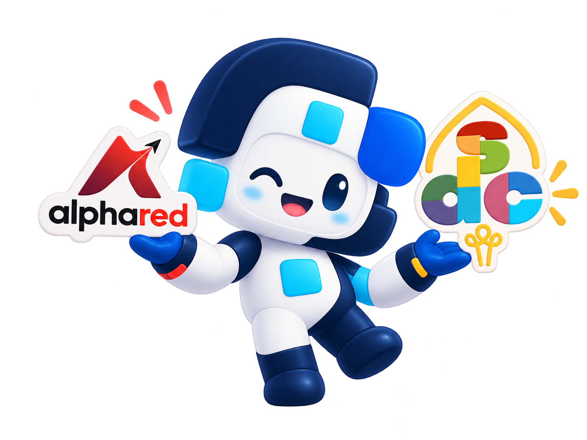
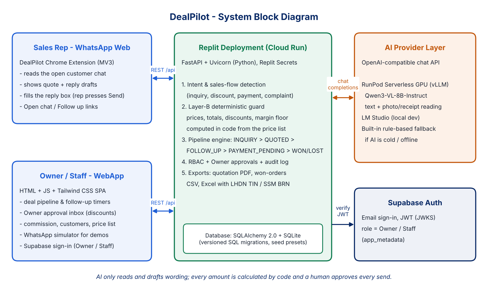

<h1>DealPilot </h1>

> Autonomous WhatsApp Web Copilot and Real-Time Deal Pipeline CRM for Malaysian SMEs powered by Local LLMs & RunPod Serverless GPU.

---

## Team Information

| Field                  | Details                                     |
| ---------------------- | ------------------------------------------- |
| **Team Name**          | bug+work=feature                            |
| **Team Domain**        | Domain 2: Orbyte Smart SME Challenge ("Less Busywork, Better Business") |
| **SDG Track (1–17)**   | SDG 8 — Decent Work and Economic Growth     |
| **Team Leader**        | Ng Jing Xuan                                |
| **University**         | Universiti Teknologi Malaysia (UTM)         |
| **Number of Members**  | 5                                           |

## Links

| Resource          | Link                                           |
| ----------------- | ---------------------------------------------- |
| GitHub Repository | https://github.com/tiffanyxuan06-png/DealPilot  |
| Live Demo         | https://deal-pilot.replit.app                  |
| RunPod Endpoint   | https://api.runpod.ai/v2/your-endpoint-id      |
| Slide Deck        | https://canva.link/hcyqxtvc61qz2xj             |
| Demo Video        | [Link to Demo Video]                           |

---

## Overview

### Problem

In Southeast Asia, over **80% of micro and small businesses (SMEs)**—including air-conditioning contractors, hardware suppliers, wholesalers, and equipment specialists—conduct daily commercial sales negotiations directly on **WhatsApp**. However, their customer interactions are completely severed from their inventory and finance records:

1. **Quotation Chaos & Ghost Quotes:** Sales reps manually calculate prices on scrap paper or mental memory. Quotes sit unanswered in chat while other customers request the same products, leading to either accidental overselling or lost sales from artificial stock-outs.
2. **Double-Entry Friction:** Sales reps and admins waste hours re-typing WhatsApp messages, pricing figures, and customer details into fragmented Excel spreadsheets at the end of every day.
3. **Margin Leakage & Unauthorized Discounts:** Reps routinely give ad-hoc discounts to close deals quickly, eroding business margins without the business owner ever knowing until the monthly accounts close.
4. **Blind Aftersales Chasing:** When a customer receives a defective item or partial delivery and reports it in colloquial Manglish/Malay on WhatsApp, the dispute goes unrecorded on the invoice tracker—causing accounting staff to embarrassingly harass the customer for unpaid balances.

Existing accounting software (AutoCount, SQL Account, Bukku) is built for retrospective bookkeepers and is blind to WhatsApp chats. Meanwhile, generic WhatsApp chatbots (Wati, Respond.io) are blind to warehouse catalog pricing, margins, and invoice statuses.

### Solution

**DealPilot** bridges this gap as an **Autonomous WhatsApp Web Copilot + Real-Time Deal CRM** built specifically for frontline SME sales teams:

- A lightweight **Chrome Extension (Manifest V3)** embeds directly into **WhatsApp Web**, reading the active conversation in real time.
- It parses messy multi-lingual messages (English, Bahasa Melayu, Manglish), matches items against the business's actual catalog price list, and drafts tailored sales responses with 1-click insertion into the chat box.
- A **Deterministic Layer-B Guard** ensures AI never guesses prices or computes discounts hallucinatorily—all arithmetic and margin checks are strictly verified by deterministic Python services.
- The accompanying **Web Dashboard** provides business owners with real-time pipeline visibility, rep commission leaderboards, automated 2-hour/48-hour follow-up timers, formal quotation PDF generation, and 1-click bookkeeper-ready Excel exports with LHDN TIN/SSM numbers.

### Measurable Impact & Expected Outcomes

| Metric / Goal | Before DealPilot (Manual & Spreadsheets) | With DealPilot (Automated) | Measurable Business Benefit |
| :--- | :--- | :--- | :--- |
| **Sales Rep Admin Time** | 2 to 3 hours spent every evening re-typing WhatsApp chats into Excel rows. | 1-click in-chat quote generation and instant pipeline synchronization. | **Saves 10–15 hours/week per sales rep** for active revenue generation. |
| **Pricing & Margin Errors** | Frequent math errors, unapproved discounts, and out-of-date pricing in chat. | Layer-B deterministic price matcher strictly enforces catalog rates & margin floors. | **0% AI pricing hallucinations**; eliminates unintended discount margin bleed. |
| **Lead Abandonment & Ghost Quotes** | Unanswered quotes sit in chat; reps forget to follow up; stock is held indefinitely. | Automated 2-hour and 48-hour follow-up cadences with 1-click WhatsApp launcher. | **Recovers 15%–20% of stalled deals** before leads go cold to competitors. |
| **Aftersales Dispute Handling** | Angry customer withheld balance; accounting unaware, continued automated payment chasing. | AI recognizes Manglish/Malay complaints and auto-pauses payment chasing immediately. | **100% prevention of embarrassing dispute escalations**; Owner resolves in 1 click. |

> **The 10-Second Explain-It-Back Test:**  
> *"When a customer asks for stock on WhatsApp, DealPilot checks live inventory, drafts the quote from your price list, and locks the units on hold—protecting margins and eliminating evening spreadsheet data entry in one click."*

---

### Strategic Fit with Orbyte (Zero Feature Duplication)

DealPilot is engineered from the ground up to **complement Orbyte's platform without duplicating its core capabilities**:

1. **Clean Architectural Boundaries:**
   - **Orbyte Core:** Excels at **internal HR, employee operations, and administrative workflows** (`eLeave`, `eClaim`, `Attendance`, and internal company governance).
   - **DealPilot Module:** Powers the **external commercial, sales negotiation, inventory reservation, and cashflow cycle** (`WhatsApp Frontline Sales`, `Price Floor Guard`, `Quotation PDFs`, `Deal Pipeline`, and `Bookkeeper LHDN Exports`).
2. **Plugs into Orbyte Workflows:** DealPilot integrates seamlessly with Orbyte's administrative paradigm, respecting Orbyte Role Switcher principles (`Owner` vs. `Staff`) and outputting immutable events directly compatible with Orbyte audit feeds.
3. **Multi-Industry Reusability Across SMEs:** Unlike single-industry point solutions, DealPilot includes pre-configured synthetic profile datasets (`backend/schema/seeds/`) allowing instant zero-typing onboarding across diverse SME domains:
   - **Contractors & Service Specialists:** (e.g. *Sejuk Jaya Aircond Sdn Bhd* — equipment, horsepower tiers, installation labor rules).
   - **Wholesale & Distribution:** (e.g. *Kopi & Bakery Wholesale* — bulk carton volume pricing, perishable stock).
   - **Digital & Software Agencies:** (e.g. *Nexus Cloud Studio* — milestone deliverables, retainer billings).

---

### The Core Automated Journey (Domain 2 Rubric Alignment)

Every interaction in DealPilot strictly fulfills the 5-phase automated journey required by the Domain 2 challenge:

```
[1. Trigger] ──► [2. Connected Data] ──► [3. Decision Logic (AI + Rules)] ──► [4. Human Approval] ──► [5. Visible Outcome & Audit Log]
```

1. **Trigger (Inbound Customer Action):**
   - Customer messages on WhatsApp asking for a quotation (*"Boss need 3 units Daikin 1.5HP with installation to Subang"*), confirming a payment deposit, or reporting a defective unit in Manglish.
   - Alternatively, a phone call is received and logged via the WebApp 1-line inquiry bar.
2. **Connected Data (Enterprise Context Retrieval):**
   - DealPilot instantly aggregates live catalog pricing, unit cost floors, customer purchase history, assigned sales rep, and buyer LHDN TIN/SSM records from the database.
3. **Decision Logic (AI Proposes, Deterministic Rules Enforce):**
   - **AI Layer (RunPod vLLM / Qwen3-VL-8B):** Extracts semantic intent, item models, requested quantities, and delivery constraints from informal multi-lingual text.
   - **Deterministic Layer-B Guard (Python):** Computes exact line totals, validates stock availability, enforces minimum profit margin thresholds, and schedules 2h/48h aging countdowns.
4. **Human Approval (People Stay in Control):**
   - **Staff:** Reviews AI-drafted reply options (Consultative, Quick Close, Friendly) in the Chrome Extension and inserts the chosen text with 1 click.
   - **Owner:** If a quote requests an unauthorized discount exceeding the margin floor, or marks a deal won/cancelled, DealPilot automatically holds the action and routes an approval card to the Owner's Dashboard.
5. **Visible Outcome & Immutable Audit Record:**
   - The verified message or quotation PDF is dispatched directly into WhatsApp Web via `web.whatsapp.com/send`; the deal stage updates on the live pipeline; and an immutable event is recorded to the append-only activity log.

---

### Key Features

1. **WhatsApp Web In-Chat Copilot (`extension/`):**
   - Automatically detects buying inquiries, price requests, payment confirmations, and customer complaints directly inside `web.whatsapp.com`.
   - Generates contextual, multi-style reply options (Consultative, Quick Close, Friendly, Direct) and writes drafts directly into the WhatsApp input box.
   - Extracts phone numbers directly from WhatsApp message identifiers, allowing instant sync even for unsaved contact names.
   - Features 1-click **"Open Chat"** and **"Follow Up"** launchers that open `web.whatsapp.com/send?phone=...` directly into the customer's chat.

2. **Deterministic Layer-B Margin Guard (`backend/services/prompts.py`):**
   - **Zero AI Price Hallucination:** LLMs extract customer intent and requested quantities, but all pricing, line totals, and margin percentages are computed deterministically against the business catalog.
   - Enforces minimum margin floors: if a discount breaches the business threshold, the action is automatically gated behind an Owner Approval workflow.

3. **Autonomous Deal Pipeline & Follow-Up Engine (`backend/routes/deals.py`):**
   - 5 standardized deal stages: `INQUIRY` $\rightarrow$ `QUOTED` $\rightarrow$ `FOLLOW_UP` $\rightarrow$ `PAYMENT_PENDING` $\rightarrow$ `WON` / `LOST`.
   - Automatic overdue detection: flags stalled quotes after 2 hours (or custom SME threshold) and drafts targeted re-engagement messages.
   - Mandatory loss-reason tracking (`PRICE_TOO_HIGH`, `COMPETITOR`, `GHOSTED`, `OUT_OF_STOCK`, etc.) to give owners pipeline intelligence.

4. **Role-Based Access Control & Owner Approvals (`backend/services/permissions.py`):**
   - Role separation between **Owner** (`Encik Hafiz`) and **Staff** (`Aina`).
   - High-impact actions (custom discounts, deal cancellations, won order approvals, catalog modifications) queue into the Owner Approval inbox.
   - Immutable append-only audit trail logging every financial modification and permission switch.

5. **Formal PDF Quotations & Export Suite (`backend/routes/exports.py`):**
   - Generates professional Quotation PDFs with Malaysian standard terms (*"Subject to stock availability · prices valid 7 days"*).
   - 1-click CSV export of won orders for warehouse fulfillment.
   - 1-click multi-sheet Excel export capturing customer profiles, deal history, and Malaysian LHDN e-Invoicing identifiers (Buyer TIN & SSM BRN) for monthly bookkeeping.

6. **60-Second Zero-Typing SME Onboarding & Sandbox Simulator:**
   - Multi-SME presets (Aircond Contractor, Wholesale F&B, Software Services) allow instant demonstration across diverse industries.
   - Integrated **WhatsApp Simulator** inside the WebApp allowing judges and evaluators to test full conversational flows without linking a physical WhatsApp phone.

### Tech Stack

| Layer | Technology | Purpose |
| :--- | :--- | :--- |
| **Frontend WebApp** | HTML5, Vanilla JavaScript (ES6+), Tailwind CSS (Browser runtime) | Single-page CRM dashboard, deal pipeline board, customer hub, and commission ledger |
| **Chrome Extension** | Chrome Manifest V3, Content Scripts, CSS3 | Embedded sidebar inside `web.whatsapp.com` with real-time DOM observers and message injection |
| **Backend API** | Python 3.11+, FastAPI, Uvicorn, Pydantic v2 | High-performance asynchronous REST API, route handlers, and deterministic business logic |
| **Database & ORM** | SQLite, SQLAlchemy 2.0, Raw SQL Migrations | Relational storage with automated schema migration runner (`001` through `004`) and JSON seeders |
| **AI / GPU Inference** | RunPod Serverless GPU (`Qwen/Qwen3-VL-8B-Instruct`), LM Studio (Local Dev) | Unified multi-lingual conversational comprehension (English, Malay, Manglish) and multimodal vision document extraction |
| **Hosting & Cloud** | Replit, Cloud Run | Cloud hosting with automated deployment via `.replit` and continuous availability |

---

## Project Structure

```text
.
├── backend/                                       # FastAPI Backend Application
│   ├── app.py                                     # Server entry point & CORS/route registration
│   ├── config.py                                  # Pydantic Settings & environment variable loader
│   ├── db/                                        # Data layer: SQLAlchemy engine, migration runner, seeder
│   │   ├── engine.py                              # Database connection & session factory
│   │   ├── migrate.py                             # Sequential SQL migration executor
│   │   ├── orm.py                                 # SQLAlchemy ORM table definitions
│   │   └── seed.py                                # Dynamic JSON seed populator
│   ├── models/                                    # Data transfer objects & entity models
│   │   ├── entities.py                            # Domain entity schemas
│   │   ├── enums.py                               # Deal stages, roles, intent types
│   │   ├── requests.py                            # Validated API request models
│   │   ├── responses.py                           # Strongly typed API responses
│   │   └── settings.py                            # SME configuration schemas
│   ├── routes/                                    # REST API router endpoints
│   │   ├── company_ai.py                          # SME business analytics Q&A
│   │   ├── deals.py                               # Deal CRUD, state machine, pipeline actions
│   │   ├── exports.py                             # Quotation PDF, won orders CSV, LHDN Excel exports
│   │   ├── onboarding.py                          # 60-second quick setup & profile switcher
│   │   ├── sidekick.py                            # Deterministic WhatsApp sidekick tool endpoints
│   │   ├── state.py                               # Global CRM state synchronization
│   │   ├── team.py                                # Sales reps, commissions & permissions
│   │   └── whatsapp.py                            # Inbound message parsing & reply generation
│   ├── schema/                                    # Database schema migrations & demo seeds
│   │   ├── migrations/sqlite/                     # 001_initial, 002_commitments, 003_product_specs, etc.
│   │   └── seeds/                                 # Industry seed data (aircond.json, fnb.json, mock.json)
│   └── services/                                  # Business logic & external service integrations
│       ├── ai_provider.py                         # Unified AI switch: RunPod vLLM vs. LM Studio
│       ├── auth.py                                # Session authentication & Supabase token verification
│       ├── intent.py                              # Intent recognition (Buying, Payment, Aftersales)
│       ├── lmstudio.py                            # OpenAI-compatible client with retry & fallback
│       ├── memory.py                              # Customer memory, previous deals & context builder
│       ├── permissions.py                         # Owner vs. Staff RBAC engine & approval gates
│       ├── pipeline.py                            # Pipeline stage progression & deal transitions
│       ├── price_match.py                         # Fuzzy catalog matching & tier pricing
│       ├── prompts.py                             # System prompts & consultative sales playbooks
│       ├── sales_flow.py                          # Multi-step sales qualification flow
│       └── vision.py                              # Receipt & invoice OCR verification engine
├── docs/                                          # Architecture specifications, PRDs & user flow guides
│   └── dealpilot_architecture.png                 # System block diagram
├── extension/                                     # DealPilot WhatsApp Web Chrome Extension (MV3)
│   ├── manifest.json                              # Chrome Extension Manifest V3 configuration
│   ├── content.js                                 # In-page DOM observer, message scraper & sidebar UI
│   ├── sidebar.css                                # Extension styling, theme tokens & responsive layout
│   ├── background.js                              # Service worker handling cross-origin requests
│   └── img/                                       # Extension logo, avatars & mascot assets
├── runpod/                                        # RunPod serverless worker (GPU workload)
│   ├── handler.py                                 # Qwen3-VL-8B-Instruct on vLLM, OpenAI-compatible routes
│   ├── requirements.txt                           # Worker dependencies (runpod, vllm)
│   └── Dockerfile                                 # Worker image for RunPod Serverless
├── submission/                                    # Required SDC Hackathon 2026 submission documents
│   ├── SDC2026_bug+work=feature_Preliminary.pdf           # Preliminary submission form
│   ├── SDC2026_bug+work=feature_TechDeclaration.pdf       # Technology declaration
│   ├── SDC2026_bug+work=feature_Replit_POU.pdf           # Replit proof of use
│   └── SDC2026_bug+work=feature_Runpod_POU.pdf           # RunPod proof of use
├── test/                                          # Automated testing suite
│   ├── unit/                                      # Pytest unit tests (278 tests)
│   │   ├── test_deals.py                          # Deal transitions & pipeline state machine
│   │   ├── test_extension.py                      # Extension mock DOM & harness tests
│   │   ├── test_permissions.py                    # RBAC Owner/Staff permission checks
│   │   ├── test_pipeline.py                       # Stage progression & aging timers
│   │   ├── test_runpod.py                         # Mock RunPod serverless provider tests
│   │   ├── test_sales_flow.py                     # Consultative inquiry & discount limits
│   │   └── conftest.py                            # Pytest fixtures & isolated test databases
│   ├── test_lmstudio_and_flow.py                  # End-to-end integration test
│   └── test_lmstudio_live_chat.py                 # Live chat playground
├── webapp/                                        # Frontend Web Application (Single-Page CRM)
│   ├── index.html                                 # Dashboard, Deals Pipeline, Customers, Reps UI
│   ├── extension.html                             # Chrome extension download & onboarding guide
│   ├── privacy.html                               # Security & customer privacy notice
│   ├── css/style.css                              # App styling & layout rules
│   └── js/                                        # Client-side state managers & controllers
│       ├── copilot.js                             # Deal copilot & WhatsApp chat simulator
│       ├── dashboard.js                           # Pipeline charts, KPI cards, table interactions
│       ├── pdf_export.js                          # Client-side PDF generation & print styles
│       └── state.js                               # Backend state hydration & offline fallback
├── .env.example                                   # Sample environment configuration template
├── .gitignore                                     # Git ignore patterns (secrets, db files, caches)
├── .replit                                        # Replit execution & Cloud Run deployment config
├── LICENSE                                        # Apache 2.0 open-source license
├── requirements.txt                               # Production Python dependencies
├── requirements-dev.txt                           # Testing & development dependencies
├── run_server.py                                  # Standalone server runner with auto-encoding
├── start_dealpilot.bat                            # Windows 1-click launcher
└── README.md                                      # Project overview & submission documentation
```

### Architecture



```
                                  ┌────────────────────────────────────────────────────────┐
                                  │                  WhatsApp Web Browser                  │
                                  │       (DealPilot Chrome Extension - Manifest V3)       │
                                  └───────────────────────────┬────────────────────────────┘
                                                              │
                                      Direct JSON REST API    │  web.whatsapp.com/send?phone=...
                                      (localhost / replit)    │  (1-Click Chat Launcher)
                                                              ▼
┌───────────────────────────────┐           ┌──────────────────────────────────────────────┐
│       DealPilot WebApp        │◄─────────►│        FastAPI Backend Services Engine       │
│ • Deals Pipeline & Stages     │  REST/SSE │ • Pipeline State Machine    • Price Matcher  │
│ • Owner Approval Inbox        │           │ • Layer-B Margin Guard      • LHDN Exporter  │
│ • Sales Rep Commission Hub    │           │ • RBAC Permissions         • PDF Generator  │
└───────────────────────────────┘           └───────────────────────┬──────────────────────┘
                                                                    │
                                            OpenAI-Compatible REST  │  (vLLM Protocol)
                                            Bearer Authorization    ▼
                                            ┌──────────────────────────────────────────────┐
                                            │               AI Provider Layer              │
                                            │ • Cloud: RunPod Serverless GPU (Qwen3-VL-8B) │
                                            │ • Local: LM Studio (Local Dev Fallback)      │
                                            │ • Deterministic Fallback: Zero Downtime      │
                                            └──────────────────────────────────────────────┘
```

---

## How to Run

### Option 1 — Run on Replit (Recommended)

1. Import this repository into Replit via **Create Repl → Import from GitHub** (`https://github.com/tiffanyxuan06-png/DealPilot`).
2. Open the **Secrets** tab (🔒) in Replit and enter your environment configurations:
   ```ini
   AI_PROVIDER=runpod
   RUNPOD_API_KEY=rpa_your_runpod_api_key_here
   RUNPOD_ENDPOINT_ID=your_runpod_endpoint_id
   RUNPOD_MODEL=Qwen/Qwen3-VL-8B-Instruct
   ```
3. Click the **Run** button. Replit executes `python run_server.py` as specified in `.replit`, starting the server on `0.0.0.0:8000` with the WebApp available on your Replit live URL.

### Option 2 — Run Locally

#### Prerequisites
- Python 3.11 or higher
- Google Chrome / Brave / Microsoft Edge (for the Chrome Extension)
- *(Optional)* [LM Studio](https://lmstudio.ai/) with `qwen3-vl-4b-instruct` or `qwen2.5-7b-instruct` loaded on port `1234`.

#### Steps

1. **Clone the Repository:**
   ```bash
   git clone https://github.com/tiffanyxuan06-png/DealPilot.git
   cd DealPilot
   ```

2. **Set Up Python Virtual Environment:**
   ```bash
   python -m venv venv
   # Windows:
   venv\Scripts\activate
   # Linux / macOS:
   source venv/bin/activate
   ```

3. **Install Dependencies:**
   ```bash
   pip install -r requirements.txt
   ```

4. **Configure Environment:**
   ```bash
   cp .env.example .env
   ```
   *(By default, `.env` runs local SQLite at `backend/cashchase.db` and connects to LM Studio at `http://127.0.0.1:1234/v1`).*

5. **Start DealPilot Server:**
   ```bash
   python run_server.py
   # Or on Windows, double-click: start_dealpilot.bat
   ```
   - Web Dashboard: `http://localhost:8000/`
   - Interactive OpenAPI Docs: `http://localhost:8000/docs`

6. **Load the WhatsApp Web Chrome Extension:**
   - Open your Chromium browser and navigate to `chrome://extensions`.
   - Enable **Developer mode** (toggle in the top-right corner).
   - Click **Load unpacked** (top-left button).
   - Select the **`extension/`** directory in this repository.
   - Open [web.whatsapp.com](https://web.whatsapp.com/). The DealPilot Copilot sidebar will dock to the right of your WhatsApp chats!

### Run Tests

Execute the automated test suite with pytest:
```bash
pip install -r requirements-dev.txt
python -m pytest test/unit -q
```
> **Test Suite Highlights:** All 278 automated unit tests run against an isolated SQLite memory database with full isolation from production data. LM Studio and RunPod calls are cleanly mocked to allow offline CI/CD execution without latency or token usage.

---

## How We Use Replit *(Required)*

- **Collaborative Cloud Development:** Used Replit for shared development, immediate live code testing, and multi-developer workspace integration.
- **Production Server Hosting:** Deployed the FastAPI backend and single-page CRM WebApp on Replit Deployments (`deploymentTarget = "cloudrun"` via `.replit`), ensuring constant uptime for extension API requests.
- **Zero Secret Leakage:** Production API credentials (`RUNPOD_API_KEY`, `RUNPOD_ENDPOINT_ID`, `SUPABASE_ANON_KEY`) are managed strictly through Replit Secrets and injected into environment variables at runtime, guaranteeing that no private API keys are ever committed to git.

**Proof of use — Replit**

📄 [View Replit proof of use (PDF)](submission/SDC2026_bug+work=feature_Replit_POU.pdf)

---

## How We Use RunPod *(Required)*

- **Unified Vision-Language Serverless Inference:** DealPilot utilizes a high-performance **RunPod Serverless Endpoint** powered by vLLM running **`Qwen/Qwen3-VL-8B-Instruct`**. This single multimodal model unifies both conversational sales comprehension and visual receipt/bank slip document parsing without needing separate services.
- **Fast Multilingual Parsing:** Frontline chats in Malaysia blend English, Malay, and Chinese dialects ("Manglish"). RunPod GPU acceleration enables sub-second extraction of customer intent, product quantities, and delivery constraints.
- **Backend Architecture Integration:** All RunPod communications are routed securely through `backend/services/ai_provider.py` and `backend/services/lmstudio.py` using standard OpenAI-compatible endpoints (`/v1/chat/completions`).
- **Cold-Start Resilience:** If the RunPod endpoint is cold-starting or temporarily unreachable, DealPilot's built-in **Deterministic Fallback Engine** seamlessly serves structured rules-based replies, ensuring zero failure during live sales conversations.
- **Worker (`runpod/handler.py`):** our serverless worker loads `Qwen/Qwen3-VL-8B-Instruct` with vLLM and answers RunPod's OpenAI-compatible routes (`/v1/chat/completions`, `/v1/models`), so the backend calls it without any change. It also accepts a plain job: `{"input": {"prompt": "..."}}` on `/runsync`. The handler is covered by `test/unit/test_runpod_handler.py` (fake model, no GPU needed).

Deploy the worker:
1. Build and push the image: `docker build -t <dockerhub-user>/dealpilot-runpod:latest runpod/` then `docker push <dockerhub-user>/dealpilot-runpod:latest` (or connect this GitHub repo in RunPod and point it at `runpod/Dockerfile`).
2. In RunPod → **Serverless → New Endpoint**, use that image on a 24 GB+ GPU and set `MODEL_NAME=Qwen/Qwen3-VL-8B-Instruct` (optional: `MAX_MODEL_LEN`, `GPU_MEMORY_UTILIZATION`).
3. Put the endpoint ID and API key in Replit Secrets as `RUNPOD_ENDPOINT_ID` and `RUNPOD_API_KEY`, and set `AI_PROVIDER=runpod`.

Plain job example:
```bash
curl -X POST https://api.runpod.ai/v2/$RUNPOD_ENDPOINT_ID/runsync \
  -H "Authorization: Bearer $RUNPOD_API_KEY" \
  -H "Content-Type: application/json" \
  -d '{"input": {"prompt": "Boss, 3 unit Daikin 1.5HP how much?"}}'
```

Example Request (OpenAI-compatible, as the backend sends it):
```bash
curl -X POST https://api.runpod.ai/v2/$RUNPOD_ENDPOINT_ID/openai/v1/chat/completions \
  -H "Authorization: Bearer $RUNPOD_API_KEY" \
  -H "Content-Type: application/json" \
  -d '{
    "model": "Qwen/Qwen3-VL-8B-Instruct",
    "messages": [
      {
        "role": "system",
        "content": "You are DealPilot Sales Copilot. Extract requested products and draft a Malaysian SME quote."
      },
      {
        "role": "user",
        "content": "Boss, need 3 units Daikin 1.5HP with installation to Subang Jaya. Got discount?"
      }
    ]
  }'
```

**Proof of use — RunPod**

📄 [View RunPod proof of use (PDF)](submission/SDC2026_bug+work=feature_Runpod_POU.pdf)

---

## Challenges, Hardest Risks & Fallback Architecture

### Naming Our Hardest Risks & Built-In Fallback Strategies

| Hardest Identified Risk | Worst-Case Failure Scenario | Engineered Fallback & Mitigation Strategy |
| :--- | :--- | :--- |
| **Risk 1: WhatsApp Web Internal DOM Changes** | WhatsApp deploys an unannounced frontend update, obfuscating CSS selectors and breaking extension message scrapers. | **Dual-Engine Fallback:** Multi-layer fallback selectors using ARIA accessibility trees + WhatsApp message-ID phone extraction. When DOM injection is disrupted, users can seamlessly utilize the standard `web.whatsapp.com/send?phone=...` protocol or test full end-to-end flows using the in-app **WhatsApp Simulator**. |
| **Risk 2: RunPod GPU Cold-Starts & Network Latency** | GPU container is cold-starting or experiences network timeouts (>15s), freezing frontline chat replies. | **Instant Deterministic Fallback Engine:** If RunPod times out or fails health checks, DealPilot instantly falls back to local deterministic rule matching (`backend/services/sales_flow.py`). Frontline staff always receive instant, calculated quote replies with 0% downtime. |
| **Risk 3: AI Price Arithmetic & Margin Hallucination** | LLMs calculate 5x350 = 1850 or invent an unauthorized 25% discount, causing severe financial margin loss. | **Layer-B Deterministic Architecture:** LLMs are strictly quarantined from financial calculations. All math, line items, and discounts are computed deterministically in Python against the catalog price list before reaching staff. |
| **Risk 4: Dependence on Live Orbyte Platform Access** | Live Orbyte API endpoints are unavailable or restricted during judging/evaluation. | **Zero Live Orbyte Dependency:** DealPilot is architecturally autonomous. It operates with its own lightweight RBAC system (`Owner` vs. `Staff`), automated database migrations, synthetic multi-SME demo datasets (`aircond.json`, `fnb.json`, `mock.json`), and built-in interactive simulators—running 100% locally or on Replit without requiring external Orbyte credentials. |

---

## Future Improvements

- [ ] **Malaysian LHDN MyInvois Direct e-Invoicing:** Expand the current Buyer TIN/BRN tracking into live API submission to the Malaysian Inland Revenue Board (LHDN) MyInvois portal.
- [ ] **Automated WhatsApp Multi-Touch Cadence:** Allow business owners to define automated WhatsApp follow-up schedules (e.g., 2 hours, 24 hours, 72 hours) with dynamic message variations.
- [ ] **Voice Note Transcription via RunPod Whisper:** Enable direct speech-to-text transcription of customer WhatsApp voice notes into structured quotation line items.
- [ ] **Multi-Agent Aftersales Diagnostic:** Automated triage agent that correlates warranty claims against past delivery dates and serial numbers before proposing replacement stock.

---

## Team

| Name | Role | GitHub |
| :--- | :--- | :--- |
| **Ng Jing Xuan** | Team Lead / Frontend, Chrome Extension & WhatsApp Integrations | [@tiffanyxuan06-png](https://github.com/tiffanyxuan06-png) |
| **Frederick Tiong Kong Yao** | Backend, AI & System Architecture | [@fredericktky](https://github.com/fredericktky) |
| **Lim Yue Qi** | UI/UX Design, Testing & Quality Assurance | [@yukilim-404](https://github.com/yukilim-404) |
| **Tay Jun Ren** | Slide Preparation | [@tayjunren](https://github.com/tayjunren) |
| **Clement Teo** | Video Demo | [@Clemement](https://github.com/Clemement) |

---

## Submission Checklist

- [ ] Team name, domain (Domain 2) and SDG track filled in
- [x] Slide deck link added
- [ ] Demo video link added
- [ ] Replit used, with proof of use in `submission/`
- [ ] RunPod used, with proof of use in `submission/`
- [ ] Preliminary submission completed (`SDC2026_bug+work=feature_Preliminary.pdf`)
- [ ] Technology declaration completed (`SDC2026_bug+work=feature_TechDeclaration.pdf`)
- [x] Submission files renamed with your team name (`bug+work=feature`)
- [ ] "How to Run" steps verified
- [ ] No API keys or secrets committed to the repository

## License

This project is licensed under the [Apache License 2.0](LICENSE).
