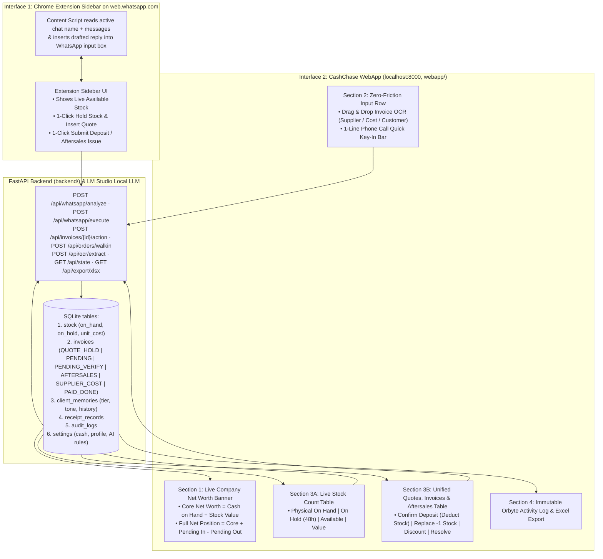

# CashChase — User Flows, WebApp UI & Local LLM Agent Spec

**Architecture Rule:** Strictly **2 user-facing interfaces** backed by **1 FastAPI backend (`backend/`) & 1 SQLite database (`backend/cashchase.db`)**:
1. **Chrome Extension Sidebar on `web.whatsapp.com`** (`extension/`: `content.js` injects the sidebar, `background.js` calls the API)
2. **ONE CashChase WebApp (`http://localhost:8000/`)** with a left sidebar: *Overview & Net Worth*, *Invoices & Quotes*, *Stock & 48h Holds*, *Ledger*, and a built-in *WhatsApp Simulator* (backup for the extension), plus the *SME Profile & AI Labor Rules* settings.

---

## 1. Visual Architecture & How Everything Connects



---

## 2. Step-by-Step User Flows (Click-by-Click)

### Flow 1: WhatsApp Inquiry → Quotation & 48-Hour Stock Hold
1. **Trigger:** Customer texts on WhatsApp: *"Boss, got 5 units Daikin 1.5HP and 5 bottles R32 gas? How much?"*
2. **Extension Reads & Checks:** The Extension Sidebar sends the message + current catalogue state to `POST /api/whatsapp/analyze`.
3. **Rule Verification:**
   - Checks `Available Stock = Physical On Hand - Stock On Hold`.
   - Computes total from official catalogue prices (`5 × RM 1,150 + 5 × RM 180 = RM 6,650`).
4. **Human Action (1 Click):** Sales/Admin clicks **`[✅ Hold Stock (48h) & Insert Quote Reply]`**.
5. **Outcome:**
   - Creates `QT-104` (`QUOTE_HOLD`) on the WebApp (Invoices & Quotes page).
   - Increases `on_hold` by `+5` on both items with a **48-hour countdown timer** (**does NOT deduct `on_hand` yet!**).
   - Auto-fills the WhatsApp Web chat box with the formatted quote reply.

---

### Flow 2: Order Confirmed & Deposit Paid → Physical Stock Deduction
1. **Trigger:** Customer replies on WhatsApp with confirmation & deposit receipt (*"Confirm QT-104, banked in RM 2,000 deposit"*).
2. **Extension / WebApp Detection:** Matches `QT-104` and extracts `RM 2,000` deposit.
3. **Role Guardrail:** If logged in as `Sales/Admin`, button says **`[📤 Submit for Owner Confirmation]`**. If `Owner`, button says **`[🔒 Owner: Confirm Deposit & Deduct Physical Stock]`**.
4. **Outcome When Owner Confirms:**
   - Releases the 5 units from `on_hold` (`-5`) AND deducts them from physical `on_hand` (`-5`).
   - Increases `Cash on Hand` by `+RM 2,000`.
   - Converts `QT-104` into Pending Customer Invoice `INV-204` (`Balance: RM 4,650`).
   - Updates **Company Net Worth** and logs the Owner's confirmation.

---

### Flow 3: Ghosted Quote (48-Hour Auto-Release)
1. **Trigger:** A quoted customer does not pay the deposit within 48 hours (`QT-101` expires).
2. **Action:** System highlights `QT-101` as **`HOLD_EXPIRED`**. Staff or Owner clicks **`[🔓 Release Held Stock]`** (or auto-release runs on check).
3. **Outcome:** Returns the held units back to `Available Stock` so other customers can purchase them, and drafts a polite WhatsApp follow-up + LHDN TIN request.

---

### Flow 4: 1-Drop Invoice Upload (Supplier Stock, Operating Cost, Customer Receipt) & Phone Calls
Located on the **Invoices & Quotes** page of the WebApp (`POST /api/ocr/extract` for uploads, `POST /api/orders/walkin` for phone orders):
1. **Supplier Stock Invoice Upload (e.g., Bought `+20x R32 Gas @ RM 130 = RM 2,600`):**
   - AI OCR extracts supplier name, matched SKU (`GAS-R32`), quantity (`+20`), and total (`RM 2,600`).
   - Clicking **Confirm** increases `Physical Stock On Hand` (`+20 units`, `+RM 2,600 Stock Value`) and reduces `Cash on Hand` (`-RM 2,600`) or adds to `Unpaid Supplier Bills`.
2. **Operating Cost / Expense Bill Upload (e.g., Shop Rent / Delivery Van Fuel `RM 650`):**
   - AI OCR extracts payee and amount.
   - Clicking **Confirm** reduces `Cash on Hand` (`-RM 650`, reducing Core Net Worth) with no stock change.
3. **Customer Payment Receipt Upload (e.g., DuitNow `RM 1,650` for `INV-202`):**
   - Owner clicks **Confirm Payment** → Closes `INV-202` and increases `Cash on Hand` (`+RM 1,650`).
4. **Phone Call / Walk-In Quick Key-In:**
   - When a customer calls on the phone instead of WhatsApp, staff types 1 line in the **Phone Call Bar** (e.g., *"Hotel Seri Alam called, wants 2x Daikin 1.5HP"*) and clicks **`+ Create Quote (Hold Stock)`**.

---

### Flow 5: Money-First Aftersales (Right on the Invoice Row)
1. **Trigger:** Customer complains on WhatsApp (*"Boss, 1 bottle R32 from INV-201 valve leaking, I hold the RM 4,800 balance until you replace or discount"*).
2. **Automatic Guardrail:** CashChase immediately sets `INV-201` to **`AFTERSALES_PAUSED`** so payment reminders are blocked.
3. **Owner Resolution (1 Click in Extension or on the WebApp Invoice Row):**
   - **Option A — `📦 -1 Stock Replace`:** Deducts `1 unit` from `Physical Stock On Hand` as a warranty replacement cost (reducing Stock Value by `RM 130` so Company Net Worth stays accurate) and drafts the apology reply.
   - **Option B — `💸 -RM Discount`:** Reduces the `INV-201` balance (e.g., `-RM 180`) and drafts the updated invoice balance reply.
4. **Closing the Loop:** Once delivered (or if 3 days pass with no further complaint), the Owner clicks **`[✓ Mark Resolved]`** on the `INV-201` row to return it to normal `PENDING_PAYMENT` status.

---

### Flow 6: Adding Labor Cost & On-Site Extra Piping / Materials to an Invoice
In real contractor/service SMEs, quotes and invoices include **Labor Charges** plus **extra materials used on site** (e.g., extra copper piping, trunking, brackets, or gas top-up):
1. **Low-Startup Owner Labor & Cost Framework (4 Presets + 1-Sentence Custom Generator):**
   - To keep startup time under 15 seconds for any SME, the Owner can either click one of **4 Industry Labor Presets**:
     - **Preset 1 — Contractor / Aircond:** Per-unit installation labor (`RM 250/unit`, installer cost `RM 120`) + extra piping/parts (`RM 150/set`, deducts physical stock).
     - **Preset 2 — Software / Agency:** Base license/package + custom dev / Change Requests billed at `RM 600 / Man-Day` (internal dev cost `RM 250/day`).
     - **Preset 3 — Wholesale / F&B:** Standard delivery `RM 50/trip` (driver cost `RM 35`, free > `RM 1,500`) + urgent lorry rush `+RM 120`.
     - **Preset 4 — Custom Retail / PC Build:** Flat assembly labor `RM 80/order` (tech cost `RM 35`) + physical parts deducted on deposit.
   - **OR type 1 sentence in the Custom Framework Prompt:** e.g., *"We install solar panels: RM 400 labor per panel (subcon cost RM 180) and RM 25/m extra DC cable"* → Clicking **`⚡ Generate Rules`** formats it into the structured `OWNER_BUSINESS_AND_LABOR_FRAMEWORK` block injected into `qwen3:4b`.
2. **Adding Extra Piping & Labor to an Active Invoice (`➕ Add Extra Pipe / Labor`):**
   - Triggered via **WhatsApp Extension** (*"Site used 2 extra sets copper pipe + installation labor"*), the **Phone Call Bar**, or the **`➕ Add Pipe / Labor`** button right on any `PENDING` invoice row.
   - **Automatic Stock & Net Worth Impact:**
     - **Extra Stock Used (`-2x Copper Pipe Set`):** Deducts `-2` from `Physical Stock On Hand` (`-RM 192 Stock Value`) and adds `+RM 300` (`2 × RM 150 sell price`) to the Customer's Pending Invoice balance.
     - **Labor Charge & Installer Cost:** Adds `+RM 350` (Customer Labor Charge) to the Customer's Pending Invoice balance, and deducts `-RM 150` (Installer/Subcon Labor Cost) from `Cash on Hand` (or adds to `Payables`).
     - Drafts an updated WhatsApp invoice summary for the customer in 1 click.

---

## 3. Agent Formatted Text Specification (Local LLM First)

To make sure a fast **Local LLM** (`LM Studio` running `qwen3-vl-4b-instruct` or `qwen3-4b-instruct`) returns 100% reliable results without hallucinating prices or math, we use a **strict Input Text Envelope** and **strict JSON Output Schema**.

### 3.1 Environment Configuration (`.env`, copied from `.env.example`)
```env
# "lmstudio" (default) | "runpod" | "auto"
AI_PROVIDER=lmstudio

# Option A: LM Studio local server (Developer tab → Start Server, port 1234, CORS on)
LMSTUDIO_BASE_URL=http://127.0.0.1:1234/v1
LMSTUDIO_API_KEY=lm-studio
LMSTUDIO_MODEL=local-model
LMSTUDIO_VISION_MODEL=auto

# Option B: RunPod serverless vLLM (OpenAI-compatible)
RUNPOD_BASE_URL=https://api.runpod.ai/v2/<ENDPOINT_ID>/openai/v1
RUNPOD_API_KEY=rpa_...
RUNPOD_MODEL=Qwen/Qwen3-4B-Instruct

PORT=8000
```
> **Repo status:** the backend currently reads only `LMSTUDIO_URL`, `LMSTUDIO_API_KEY` and `LMSTUDIO_MODEL` (`backend/database.py`); `AI_PROVIDER` and the `RUNPOD_*` values are not wired in yet, and `LMSTUDIO_BASE_URL` in `.env.example` does not match the `LMSTUDIO_URL` name the code reads. The LM Studio URL/model can also be changed at runtime from the WebApp settings (`POST /api/settings`). Pre-written fallback answers in `backend/services/prompts.py` keep the demo working when LM Studio is offline.

### 3.2 Exact Formatted Text Sent TO the Agent (built in `backend/services/prompts.py`)
```text
=== CASHCHASE AGENT INPUT ===
SME_COMPANY: Sejuk Jaya Aircond Sdn Bhd
USER_ROLE: OWNER
STOCK_HOLD_POLICY: 48 hours (Quotes only hold stock; physical stock deducts only after deposit confirmed)
CUSTOMER: Tan Bros Trading (+60 12-345 6789 | LHDN_TIN: C2088391020)
OPEN_RECORDS_FOR_CUSTOMER:
  - Quote #QT-104 | Amount: RM 6650 | Status: ON_HOLD_48H | Items: 5x ACN-DAI-15, 5x GAS-R32
CATALOGUE_STATE:
  - [SKU: ACN-DAI-15] Daikin 1.5HP Inverter Unit | Cost: RM 850 | Sell: RM 1150 | OnHand: 8 | OnHold: 3 | Available: 5
  - [SKU: GAS-R32] R32 Refrigerant Gas (3kg)     | Cost: RM 130 | Sell: RM 180  | OnHand: 15 | OnHold: 0 | Available: 15
  - [SKU: PIP-COP-3M] Copper Pipe 3m Set         | Cost: RM 96  | Sell: RM 150  | OnHand: 15 | OnHold: 2 | Available: 13
INPUT_SOURCE: WHATSAPP_EXTENSION
MESSAGE_TEXT:
"Boss, got 5 units Daikin 1.5HP and 5 bottles R32 gas? How much ah? Need quote urgently."
=============================
```

### 3.3 JSON Returned BY the Agent (as defined in `backend/services/prompts.py`)
```json
{
  "intent": "BUYING_INQUIRY",
  "badge": "Buying Inquiry",
  "extTitle": "Quote for Tan Bros Trading",
  "extCheck": "5x Daikin 1.5HP available (5 left) · 5x R32 available (15 left) · Total RM 6,650",
  "extActionDesc": "Inserts the selected reply into WhatsApp.",
  "extDraft": "Hi Tan Bros! Both in stock. 5x Daikin 1.5HP (RM 5,750) + 5x R32 Gas (RM 900) = RM 6,650. Send deposit anytime to confirm!",
  "replyOptions": [
    { "label": "⭐ Option 1: Best Match for Client & Your Prompt", "text": "..." },
    { "label": "🤝 Option 2: Friendly Boss Style (40% Deposit to Confirm)", "text": "..." },
    { "label": "⚡ Option 3: Fast-Close / Priority Dispatch Offer", "text": "..." },
    { "label": "🇲🇾 Option 4: Bahasa Melayu / Formal", "text": "..." }
  ],
  "extBtnLabel": "💬 Insert Selected Reply (No Stock Hold)",
  "extActionType": "REPLY_ONLY",
  "sku": "ACN-DAI-15",
  "qty": 5,
  "extraSku": "GAS-R32",
  "extraQty": 5,
  "amount": 6650
}
```

**Allowed `intent` values (6, from the prompt):**
- `BUYING_INQUIRY` — customer asks for price / stock.
- `DEPOSIT_PAID` — customer says they paid a deposit or sends a receipt.
- `AFTERSALES_ISSUE` — faulty item / complaint; pauses chasing.
- `EXPIRED_HOLD_FOLLOWUP` — follow-up on a quote whose 48h hold expired.
- `CASUAL_CHAT` — no business action.
- `CUSTOMER_DECLINED` — customer says no; reply politely, release stock.

**Executable `extActionType` values (`POST /api/whatsapp/execute`, `backend/routes/whatsapp.py`):**
- `REPLY_ONLY` — insert reply, no stock change.
- `CREATE_QUOTE_HOLD` — create a quote and put stock `On Hold (48h)`.
- `CONFIRM_DEPOSIT_DEDUCT` — `On Hold` → `-Physical Stock`, `+Cash`, create pending invoice.
- `AFTERSALES_REPLACE` — `-1` stock as warranty replacement.
- `RELEASE_EXPIRED_HOLD` — return expired hold to `Available`.

> **Quote-hold rule:** a buying inquiry gets `CREATE_QUOTE_HOLD` when every requested item is available to sell (decided in code in `backend/services/prompts.py`, not by the AI); otherwise `REPLY_ONLY`. `POST /api/whatsapp/execute` returns 409 if a hold asks for more than is available.

**Invoice row actions (`POST /api/invoices/{id}/action`):** `RELEASE_QUOTE`, `CONFIRM_QUOTE`, `MARK_PAID`, `PAY_SUPPLIER`, `SET_TIN`, `REPLACE_ONE`, `DISCOUNT`, `MARK_RESOLVED`, `ADD_PIPE_LABOR`, `ATTACH_RECEIPT`. Receipt checks: `POST /api/invoices/{id}/verify-receipt` (`decision` + optional `paidAmount`). Bills: `POST /api/bills/apply` (`supplier` / `expense` / `customer`). Release all holds on one item: `POST /api/stock/{sku}/release`.

---

## 4. Database Schema (SQLite, `backend/database.py`)

Money is stored as whole RM integers (not sen). Tables are created and seeded by `init_db()`; `POST /api/reset` re-seeds them.

1. **`settings`**: `key`, `value` (company name, SSM, TIN, `cash_on_hand`, `sme_preset`, AI labor `framework`, LM Studio URL/key/model)
2. **`stock`**: `sku`, `name`, `on_hand`, `on_hold`, `hold_note`, `unit_cost`, `sell_price`
3. **`invoices`** (quotes, invoices, bills): `id`, `type` (`QUOTE_HOLD` | `PENDING` | `PENDING_VERIFY` | `AFTERSALES` | `SUPPLIER_COST` | `PAID_DONE`), `party`, `phone`, `hold_timer`, `chat_idx`, `items_text`, `sku`, `qty`, `extra_sku`, `extra_qty`, `amount`, `claimed_amount`, `receipt_ref`, `status`, `lhdn`, `created_at`
4. **`client_memories`**: `customer`, `phone`, `tier`, `score`, `style_summary`, `payment_behavior`, `total_orders`, `total_paid_rm`, `last_message`, `recent_history_json`, `cached_analysis_json`, `updated_at`
5. **`receipt_records`**: `id`, `invoice_id`, `customer`, `file_name`, `file_type`, `ref`, `amount`, `file_data`, `html_preview`, `created_at`
6. **`audit_logs`**: `id`, `entry`, `created_at` (append-only by convention; not yet enforced in the database)

There is no separate `customers` table yet: customer name/phone live on `invoices` and `client_memories`, and LHDN TIN status is the `invoices.lhdn` text field.
