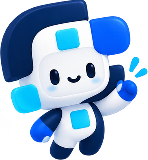
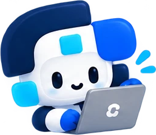
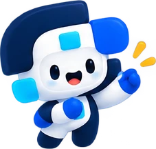
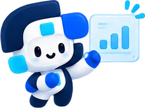
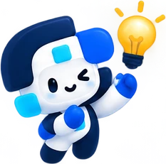
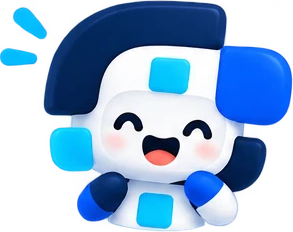
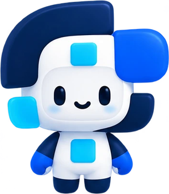
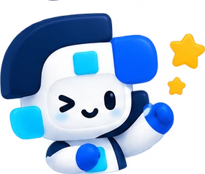
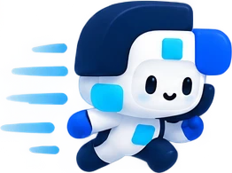

# CashChase UI Redesign: Prompts, Techniques and Images

This document records the CashChase web app redesign, so anyone can rebuild, extend or hand it over. It covers:

1. The prompts used for each part of the work, rewritten so you can reuse them.
2. Every technique used: design tokens, components, layout, motion and accessibility.
3. Every image, with where it is used, its motion and a prompt to recreate it.

The design follows `DESIGN-GUIDE.md`: IBM Plex Sans, the Orbyte colours, a soft ocean glow and frosted cards, with motion in plain CSS.

---

## 1. Prompts

Each prompt below is written to stand alone. Paste it into a new session together with the files it mentions.

### 1.1 Full web app redesign

```text
Redesign the CashChase web app (webapp/index.html, css/style.css, js/*.js) so it is
clean, friendly, consistent and easy to use. Show me a prototype; do not push.

Follow DESIGN-GUIDE.md:
- Font: IBM Plex Sans 400/500/600/700 from Google Fonts.
- Colours: Navy #042970, Blue #0152FC, Sky #01AAFC, Cyan #01E3FB,
  surfaces #F2F6FF #EEF2F8 #E6EEFF #DDF9FE #E3F6FF, ink #324564, line #9AA9C2.
  White text on navy/blue; navy text on sky/cyan.
- Ocean background: 8 drifting radial-gradient glows (18s, 23s, 27s).
- Frosted glass cards: white at ~60% with a slight blur, 16px radius, thin light border.
- One primary button colour (blue) that turns navy on hover.
- Fade-up on scroll (0.7s, 15% visible, 80-120ms stagger).
- Each mascot pose gets its own motion. Icons get their own hover motion.
- Hover lift: up 4px with a shadow over 0.2s. Logo hover: rotate 12deg, grow 10%.
- Clear blue focus ring; one reduced-motion rule that switches all motion off.
- Short, plain copy. Buttons say what happens.

Use the attached character sheet (cut each pose into its own transparent PNG with
Pillow) and the attached logo. Keep every element ID and onclick handler the JS
depends on. Replace emoji in the static HTML with SVG icons and give every form
field a visible label.
```

### 1.2 CashChase extension panel

```text
The CashChase extension panel on the WhatsApp Demo page (rendered by
renderWhatsAppView() in webapp/js/copilot.js into #ext-panel-body) is awkward:
the main button is buried under the customer history, boxes sit inside boxes,
text is 10-11px with emoji icons, and labels use system words.

Rebuild it, top to bottom:
1. Customer on one line (initials, name, tier pill, orders, total paid, score).
   Tap it to open notes, recent history and "Add note" (<details>).
2. "What's happening": the situation title, then the check results as a short
   checklist (check icon for passed checks, dot for info, total in bold).
3. "Pick a reply": radio rows; only the chosen reply shows in full. Keep the
   aftersales rebate amount and technician time inputs on the chosen option.
4. "Adjust reply" (folded <details>): custom instruction input plus offer chips.
5. One main button pinned to the bottom (position: sticky), with short labels
   ("Hold Stock (48h) & reply"). Staff view shows a small owner-only note above
   it and the label "Send to owner for approval". "Attach PDF document" below.
Show the laptop mascot with "Writing a reply..." while the AI works. Strip emoji
from scenario text at render time. Hide the floating Ask AI button on this page.
Keep every handler: selectRecommendedReply, executeExtensionAction,
promptAiCustomQuote, promptAddMemoryNote, updateAftersalesRebate,
updateAftersalesTechTime, openPdfFromChat.
```

### 1.3 Help card tweak

```text
In the sidebar "Need a hand?" card, move the mascot a little to the left so the
character and its lightbulb sit fully inside the card. Give the text enough
right padding that it never runs under the character.
```

### 1.4 Standalone prototype file

```text
Turn the web app into a standalone prototype: one index.html with style.css,
every js/*.js file and the mascot images (resized to 240px, 256-colour PNG,
base64 data URIs) inlined by a script, never copied by hand. Load Tailwind from
cdn.jsdelivr.net/npm/@tailwindcss/browser@4.1.11. Check it opens from disk with
no script errors and no broken images, then zip it for Netlify Drop or
`npx vercel`.
```

### 1.5 Tried and rejected

**Grouped sidebar.** An Ant Design-style sidebar with collapsible Business, WhatsApp and Settings groups was built and then rejected. It was reverted, and the flat sidebar was kept.

---

## 2. Tech stack

| Part | What it is |
|---|---|
| Server | Python FastAPI (`backend/app.py`). It serves `/`, `/js`, `/css` and `/img`; `/img` was added for the mascot images. |
| Styling | Tailwind utility classes plus a hand-written design layer in `webapp/css/style.css`. |
| Motion | Plain CSS keyframes. The only motion JavaScript is a small IntersectionObserver in `webapp/js/ui.js`. |
| Icons | An inline SVG sprite (Lucide-style strokes) at the top of `index.html`, used with `<svg><use href="#i-name"/></svg>`. |
| Images | Mascot poses cut from one sheet with Python Pillow, stored in `webapp/img/`. |

**Files changed:**
- `webapp/index.html`
- `webapp/css/style.css`
- `webapp/js/ui.js` (new)
- `webapp/js/dashboard.js`: page switching, filter chips and action buttons.
- `webapp/js/state.js`: confirm button style.
- `webapp/js/copilot.js`: extension panel.
- `backend/app.py`: `/img` mount.
- `webapp/img/*`

---

## 3. Design tokens

All tokens live on `:root` in `style.css`.

| Token | Value | Use |
|---|---|---|
| `--navy` | `#042970` | Headings, dark stat card, button hover, toast, floating AI button |
| `--blue` | `#0152FC` | Primary buttons, active nav, links, focus ring |
| `--sky` | `#01AAFC` | Highlights, info dots |
| `--cyan` | `#01E3FB` | Highlights on navy |
| `--surface-1` to `--surface-5` | `#F2F6FF` `#EEF2F8` `#E6EEFF` `#DDF9FE` `#E3F6FF` | Light backgrounds, pills, hover fills |
| `--ink` | `#324564` | Body text |
| `--ink-soft` | `#5B6B85` | Secondary text |
| `--line` | `#9AA9C2` | Radio outlines, strong borders |
| `--line-soft` | `#DCE4F2` | Card and input borders |
| `--glass` | `rgba(255,255,255,0.62)` | Frosted cards |
| `--glass-strong` | `rgba(255,255,255,0.82)` | Sidebar |
| `--radius` | `16px` | Cards |
| `--shadow-sm` / `-md` / `-lg` | Navy-tinted shadows | Resting, hover and modal shadows |
| `--ease` | `cubic-bezier(0.22, 1, 0.36, 1)` | Ease-out used for most motion |

**Type:**
- IBM Plex Sans for everything; IBM Plex Mono for IDs and code.
- Body text is 14px.
- `text-xs` is raised to 13px so small text stays readable.
- Page titles (`.cc-h1`) are 28px on phones and 34px on desktop. Section titles (`.cc-h2`) are 17px.

**Text colour rule:** white on navy or blue; navy on sky, cyan and the light surfaces.

---

## 4. Components

| Class | What it is |
|---|---|
| `.cc-sidebar` | Frosted sidebar (82% white, 14px blur). It becomes a top bar on phones. |
| `.nav-item` (+ `.is-active`) | Sidebar link: 44px tall, icon, label and badge. Active is solid blue with white text. |
| `.cc-header` | Sticky top bar with a blurred white background. |
| `.cc-card` | Frosted card: 62% white, 10px blur, 16px radius, thin border. |
| `.cc-hero` | Page intro strip with an eyebrow pill, a title, one sentence and a mascot. |
| `.cc-stat` | KPI card with an icon tile. It lifts on hover. |
| `.cc-btn` + `-primary` / `-ghost` / `-danger` / `-lg` | Buttons. The primary is blue and turns navy on hover. |
| `.cc-input`, `.cc-label` | 42px inputs with a visible label and a blue focus glow. |
| `.cc-chip` (+ `.is-active`) | Filter and suggestion chips. Active is navy. |
| `.cc-pill`, `.cc-dot` | Small status labels and colour dots. |
| `.cc-drop` | Dashed upload zone. |
| `.cc-tile` | Sample option tile that lifts on hover. |
| `.cc-table`, `.cc-table-wrap` | Tables with sticky soft headers and row hover, scrolling sideways inside their own box. |
| `.cc-overlay`, `.cc-modal`, `.cc-close` | Blurred navy overlay, white dialog (20px radius) and 36px close button. |
| `.cc-fab` | Floating "Ask AI" button with the happy mascot. |
| `.ext-reply`, `.ext-radio`, `.ext-footer` | Extension panel reply rows, custom radio and pinned action bar. |

**Layout:**
- Content sits in a centred column up to 1150px wide.
- The sidebar is 256px wide on desktop.
- Grids stack to one column on phones.
- The toast sits at the bottom centre, so it never covers the floating AI button.

**Styling JS-rendered markup:** some rows are rendered by JavaScript with their own classes. CSS selectors override those (list rows, primary button hover, borders) instead of editing every template string.

---

## 5. Motion

All motion is plain CSS. One rule turns it all off for people who choose "reduce motion".

### 5.1 Page-level motion

| Name | What you see | How it works | Where |
|---|---|---|---|
| Ocean background | Soft blue light drifting behind everything | Eight `<span>` circles with radial gradients (sky `rgba(1,170,252,.42)`, blue `rgba(1,82,252,.26)`, cyan `rgba(1,227,251,.42)`). Each runs `drift-a`, `drift-b` or `drift-c` over 18s, 23s or 27s, `alternate`, moving about 5vw and growing to 1.08-1.15×. | `.ocean`, fixed behind the page |
| Fade up on scroll | Cards fade in and rise 18px once | `.reveal` starts at `opacity:0; translate:0 18px`. When 15% is on screen, `ui.js` adds `.is-in`, which plays `fade-up` (0.7s, `--ease`). Cards in a row are staggered with `--d` (0, 100, 200, 300ms). The animation replays when you switch page. | Hero strips, stat cards, section cards |
| Hover lift | A card rises with a shadow | `transform: translateY(-4px)` plus `--shadow-md` over 0.2s. JS list rows lift 2px. | `.cc-stat`, `.cc-tile`, list rows |
| Logo hover | The logo tilts and grows | `rotate(12deg) scale(1.1)` over 0.25s | Sidebar brand |
| Dialog open | Dialogs ease up into place | `modal-in`: from `opacity:0`, `translateY(12px) scale(.98)`, 0.28s | `.cc-modal` |
| Floating button hover | The AI button rises | `translateY(-3px)` and the colour changes to blue | `.cc-fab` |
| Fold arrows | The arrow flips when a section opens | `rotate(180deg)` with `group-open` | Extension customer and "Adjust reply" sections |

`translate` (not `transform`) is used for the scroll reveal, so it never clashes with the hover `transform` on the same card.

### 5.2 Mascot motion (one per pose)

| Class | Motion | Keyframes | Used on |
|---|---|---|---|
| `.m-wave` | Sways side to side | `m-sway` 3.5s: rotate -4° ↔ 4°, pivot near the feet | Dashboard (wave), Stock (cheer) |
| `.m-laptop` | Small quick typing bounces | `m-type` 0.9s: translateY 0 ↔ -2px | Invoices hero, Settings dialog, extension "Writing a reply…" |
| `.m-chart` | Slow nodding tilt | `m-nod` 3s: rotate 0 ↔ -5° | Ledger hero |
| `.m-idea` | Pops bigger and wiggles | `m-pop` 2.2s: still for 70% of the cycle, then scale 1.08 with -4°, then 1.06 with 4° | Sidebar "Need a hand?" card |
| `.m-float` | Gentle floating | `m-float` 4s: translateY 0 ↔ -6px | WhatsApp hero (question), floating AI button and Ask AI dialog (happy) |
| `.m-run` | Fast footstep bounce | `m-step` 0.45s: translateY 0 ↔ -3px | Defined but not used yet |

### 5.3 Icon hover motion

Each icon reacts in its own way when its button is hovered. Each lasts about half a second.

| Class | Motion | Used on |
|---|---|---|
| `.i-hop` | Hops up 4px | Dashboard and Stock nav, stat cards, upload, download and export buttons |
| `.i-flip` | Flips around (rotateY 360°) | Invoices and Ledger nav |
| `.i-wiggle` | Wiggles ±10° | WhatsApp Demo nav |
| `.i-swipe` | Swipes sideways 3px | Send and Ask buttons |
| `.i-pulse` | Heartbeat pulse (scale 1.18) | Net worth card, Scan supplier invoice |
| `.i-spin` | Turns 90° | Settings |

### 5.4 Reduced motion

```css
@media (prefers-reduced-motion: reduce) {
  html { scroll-behavior: auto; }
  *, *::before, *::after { animation: none !important; transition: none !important; }
  .reveal { opacity: 1; translate: 0 0; }
}
```

`ui.js` also skips the observer and shows every card at once when reduced motion is on.

---

## 6. Accessibility

- Keyboard focus shows a 3px blue outline (`:focus-visible`).
- Every form field has a visible label, or a screen-reader-only label where space is tight.
- Icon-only buttons have an `aria-label`.
- Dialogs use `role="dialog"` (or `alertdialog`), `aria-modal` and `aria-labelledby`.
- The chat stream, AI answers and toast use `aria-live="polite"`.
- The reply picker uses `role="radiogroup"` / `role="radio"` with `aria-checked`.
- Decorative images and the glow layer have `alt=""` and `aria-hidden="true"`.
- Image sizes are set with `width`/`height`, so the page doesn't jump while loading.
- Buttons and nav items are at least 40-44px tall.

---

## 7. Copy style

- Headlines say one thing:
  - Dashboard: "Here is your business today."
  - Invoices: "Snap a bill. We fill it in."
  - Stock: "Quotes hold. Deposits take."
  - Ledger: "Everything, in one place."
  - WhatsApp Demo: "AI suggests. Rules check. You decide."
- Buttons say what happens: "Check bank receipt", "Confirm deposit", "Mark paid (+RM 1,650)", "Send replacement & reply".
- Use words people know, not system words: "What's happening" instead of "Auto-Cached", and a tier pill instead of "Persistent Memory".

---

## 8. Images

### 8.1 How the images were made

- **Source:** one character sheet (1536×1024, transparent background) and the logo (363×372).
- **Cutting:** Python Pillow.
  - Each pose was cropped from a hand-picked box on the sheet.
  - Each crop was then trimmed to its own content (alpha above 24).
  - Each was scaled down to fit 320×320 with Lanczos and saved as an optimised PNG.
- **Logo:** trimmed to its content and scaled to fit 192×192.
- **Standalone prototype copies:** scaled to fit 240px, reduced to 256 colours and inlined as base64. About 140KB in total.

### 8.2 Shared character description

Use this base description in every pose prompt below, so the poses stay consistent:

> A cute chibi 3D mascot built from the CashChase logo shapes: a glossy, soft-plastic toy look with a rounded white face and body. A thick navy (#042970) C-shaped block wraps over the top and left of the head like a helmet. A rounded royal blue (#0152FC) block sits on the right side like an ear. Small square sky-blue (#01AAFC) to cyan (#01E3FB) jelly gems sit on the forehead, the left cheek and the chest. It has black oval eyes, a small curved smile and light blue blush. The arms and legs are navy, with royal blue mitten hands. Soft studio lighting, gentle shadows, a transparent background, centred, with no text.

### 8.3 Image catalogue

#### Logo


- **File:** `webapp/img/logo.png`
- **Used on:** sidebar brand (tilts on hover), browser tab icon, PDF dialog header, extension header.
- **Prompt:**
  > A flat geometric logo mark on a transparent background, made of four rounded shapes forming a stylised "S" and "C". A large navy (#042970) arch at the top left, a royal blue (#0152FC) rounded square at the top right, a navy hook curving through the bottom right, a cyan (#01E3FB) leaf-shaped square at the bottom left, and a small sky blue (#01AAFC) square in the centre. Clean vector edges, no gradients, no text.

#### Waving: `mascot-wave.png`



- **Used on:** Dashboard hero, "Here is your business today." Motion: `.m-wave` sway.
- **Prompt:**
  > [Shared character description]. Three-quarter view, mid-step, one hand raised high and waving with two small sky-blue motion marks beside the hand, a friendly smile. Full body.

#### Working on a laptop: `mascot-laptop.png`



- **Used on:** Invoices hero, Settings dialog, extension "Writing a reply…". Motion: `.m-laptop` typing bounce.
- **Prompt:**
  > [Shared character description]. Sitting and typing on a grey silver laptop with a small CashChase logo on the lid, a focused happy face, and small sky-blue motion marks near the hands. Upper body.

#### Cheering: `mascot-cheer.png`



- **Used on:** Stock hero, "Quotes hold. Deposits take." Motion: `.m-wave` sway.
- **Prompt:**
  > [Shared character description]. Cheering with one fist raised, an open happy mouth, small yellow-orange spark marks next to the raised hand, and an energetic stance. Full body, small scale.

#### Showing a chart: `mascot-chart.png`



- **Used on:** Ledger hero, "Everything, in one place." Motion: `.m-chart` nod.
- **Prompt:**
  > [Shared character description]. Standing beside a floating frosted-glass panel with a small rising bar chart in sky blue, one hand pointing at the panel, a calm smile, and small sky-blue motion marks above the panel. Full body.

#### Question: `mascot-question.png`


- **Used on:** WhatsApp Demo hero (motion: `.m-float`), the confirm dialog (still).
- **Prompt:**
  > [Shared character description]. A curious thinking pose with one hand on the chin, eyes looking up, and a sky-blue question mark floating above the right side of the head. Upper body.

#### Idea: `mascot-idea.png`



- **Used on:** sidebar "Need a hand?" card. Motion: `.m-idea` pop and wiggle.
- **Prompt:**
  > [Shared character description]. Winking, holding up a glowing yellow lightbulb with short orange rays in one raised hand, and a cheerful "I have an idea" expression. Full body, small scale.

#### Happy: `mascot-happy.png`



- **Used on:** floating "Ask AI" button, Ask AI dialog header. Motion: `.m-float`.
- **Prompt:**
  > [Shared character description]. Very happy, with eyes closed in upturned arcs, a wide open smile, pink blush, both hands near the chest, and two small sky-blue motion marks at the top left. Upper body.

#### Not used yet (cut and ready)

| Image | File | Suggested use | Prompt |
|---|---|---|---|
|  | `mascot-front.png` | Empty states, onboarding | [Shared character description]. Standing straight, facing forward, arms relaxed at the sides, a gentle smile. Full body, neutral pose for a character sheet. |
|  | `mascot-excited.png` | Success after a payment is confirmed | [Shared character description]. Very excited, with eyes squeezed shut as ">" "<" shapes, a big open mouth, both fists raised, and yellow spark marks on both sides. Upper body. |
|  | `mascot-wink.png` | Tips and "did you know" hints | [Shared character description]. Winking with one fist raised, and one large and one small yellow star beside the hand. Upper body. |
|  | `mascot-run.png` | Loading or "chasing payment" states (use `.m-run`) | [Shared character description]. Running fast to the right, mid-stride, with sky-blue speed lines trailing behind on the left. Full body, side view. |

---

## 9. Rebuilding the standalone prototype

1. Copy `index.html`.
2. Swap the Tailwind script to `https://cdn.jsdelivr.net/npm/@tailwindcss/browser@4.1.11/dist/index.global.js`.
3. Inline `css/style.css` into a `<style>` tag.
4. Inline each `js/*.js` file into a `<script>` tag, escaping `</script`.
5. Replace every `img/*.png` reference with a base64 data URI of the 240px copy.
6. Open the file from disk and check for no script errors and no broken images.
7. Zip it, then deploy with Netlify Drop or `npx vercel`.

The prototype runs on sample data. AI replies, receipt reading (OCR), PDF and Excel export need the Python backend.
