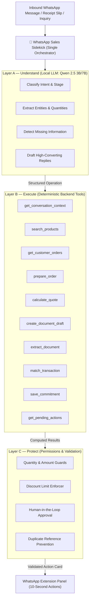
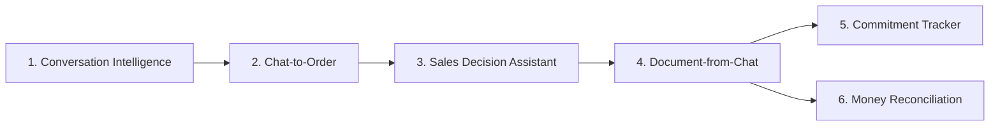
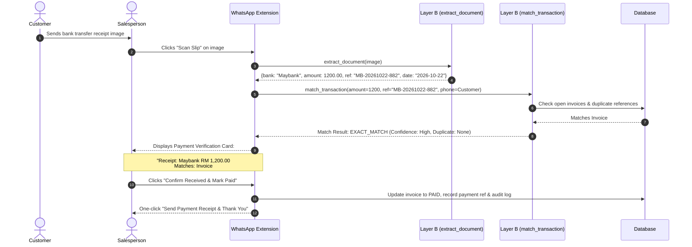

# 13. WhatsApp Sales Sidekick: Practical Agentic Architecture & Tool Registry

## Executive Summary
This document specifies the practical agentic architecture and tool registry for the DealPilot WhatsApp Sales Sidekick.

> **Design Core:** *What can a salesperson do in WhatsApp in 10 seconds that currently takes 2 minutes, requires switching apps, or is easily forgotten?*

We deliberately pivot away from an over-engineered multi-agent showcase (with 4 autonomous agents passing messages, opaque 0-100 trust scores, and fragile ReAct loops). Instead, we build **one unified Sales Sidekick** that understands the active WhatsApp chat, runs deterministic business tools in the backend, and never forces the salesperson to leave WhatsApp or chat with a bot.

---

## 1. Architectural Comparison: AI Showcase vs. Practical Sales Sidekick

| Dimension | Previous Proposal (AI Showcase) | Redesigned WhatsApp Sales Sidekick | Why It Matters |
| :--- | :--- | :--- | :--- |
| **Agent Topology** | 4 autonomous agents passing messages | **1 Orchestrator Sidekick** with modular skills & backend tools | Fast, predictable latency on local LLMs; no multi-agent deadlocks. |
| **Customer Profiling** | Opaque "Trust Score" (e.g., 94/100) | **Concrete Commitments & History** ("Promised transfer Friday 3pm") | Salespeople need actionable dates and promises, not a magic number. |
| **Payment Verification** | DuitNow regex formatting treated as proof of payment | **Evidence-Based OCR:** Receipt is evidence to inspect, not bank proof | Slip regex does not prove money landed in the merchant's account. |
| **Pricing & Margins** | Hardcoded 15% margin floors & 40% deposit | **Deterministic Rules Engine:** Configurable seller business policies | Business rules must be seller-customizable, not hardcoded into LLM prompts. |
| **LLM Tool Load** | 25+ exposed functions to a 3B/4B local model | **10 High-Value Compact Operations** cleanly separated into layers | Prevents local model confusion and hallucinated tool calls. |
| **User Experience** | Chatbot modal requiring prompt chatting | **Non-intrusive Extension Sidecar** with 10-second action pills | Salespeople keep chatting naturally; AI suggests quick action pills. |

---

## 2. The 3-Layer Architecture

### Layer A — Understand (Local LLM)
- **Role:** Understand messy, multilingual Malaysian chat (English, Manglish, Bahasa Melayu, Chinese).
- **Core Jobs:**
  - Classify intent (Greeting, Product Inquiry, Price Objection, Commitment, Payment Slip Sent).
  - Extract structured order parameters (`product_keyword`, `quantity`, `variant`, `delivery_location`).
  - Detect missing information before committing (e.g., "Confirm model variant and delivery fee").
  - Draft 3 distinct reply options (Consultative Discovery, Direct/Closing, Value-add Friendly).

### Layer B — Execute (Deterministic Backend Tools)
- **Role:** Perform 100% accurate catalog searches, database lookups, and financial calculations.
- Exposes exactly **10 compact, well-defined operations**:

| Tool Name | Parameters | Data Source | Output / Purpose |
| :--- | :--- | :--- | :--- |
| `get_conversation_context` | `phone: str` | `client_memories`, `deals` | Summary of chat context, open quotes, and active commitments. |
| `search_products` | `query: str`, `limit: int = 5` | `products` table | Fuzzy matches catalog SKUs, public pricing, and ready stock. |
| `get_customer_orders` | `phone: str`, `limit: int = 3` | `deals` table | Retrieves past orders (resolves "same as last month"). |
| `prepare_order` | `customer_id: str`, `items: list`, `delivery_area: str` | Memory / Session | Creates a structured draft order and flags missing details. |
| `calculate_quote` | `items: list`, `discount_pct: float`, `delivery_fee: float` | Deterministic Math | Computes item totals, tax/SST, authorized discounts, and grand total. |
| `create_document_draft` | `type: str ('quote'\|'invoice')`, `order_id: str` | `deals`, `invoices` | Generates official PDF/HTML document draft ready for seller review. |
| `extract_document` | `file_id: str`, `doc_type: str` | OCR / Vision | Extracts date, amount, bank name, reference ID, and sender from receipts. |
| `match_transaction` | `amount: float`, `ref_id: str`, `customer_id: str` | `deals` table | Correlates payment evidence against customer's open invoices. |
| `save_commitment` | `phone: str`, `promise_text: str`, `due_date: str`, `party: str` | `commitments` table | Saves dated promises ("customer promises to pay Friday 3pm"). |
| `get_pending_actions` | `phone: str` | `commitments`, `deals` | Retrieves overdue follow-ups, expiring quotes, and unverified payments. |

### Layer C — Protect (Permissions & Validation)
- **Role:** Enforces financial guardrails, permission boundaries, and prevents duplication.
- **Rules:**
  - Validates all quantities, amounts, and SKU identifiers before database write.
  - Enforces salesperson discount limits (e.g., max 5% without manager override).
  - **Human-in-the-Loop:** Never sends an invoice or WhatsApp message without explicit salesperson one-click confirmation.
  - Prevents duplicate reference numbers and double-counted payments.

---

## 3. The 6 Practical Sales Skills

### Skill 1: Conversation Intelligence
- Reads the full chat context rather than just the latest message.
- Distinguishes casual greetings (`"Hi boss"`) from commercial intent (`"Got 1.5hp inverter stock?"`).
- Generates 3 contextual Malaysian sales replies with accurate catalog prices embedded.

### Skill 2: Chat-to-Order
- Turns informal conversation into a structured, editable order card:
  - *"Boss, same model as last month, 12 units to Shah Alam"* $\rightarrow$ Calls `get_customer_orders` to fetch last month's SKU, sets `qty=12`, destination `Shah Alam`.
  - Surfaces missing details: *"Delivery fee to Shah Alam not yet set. Confirm stock availability."*

### Skill 3: Sales Decision Assistant
- Assists the rep when negotiating or handling objections:
  - Compares requested models with inventory stock levels.
  - Suggests authorized alternatives when an item is out of stock or over budget.
  - Shows permitted discounts or approved value-adds (e.g. Free Delivery) without breaching margin rules.

### Skill 4: Document-from-Chat
- Eliminates repetitive data entry across screens:
  $$\text{Conversation} \longrightarrow \text{Draft Order} \longrightarrow \text{Quotation} \longrightarrow \text{Tax Invoice}$$
- Customer details, item quantities, and pricing are entered once and reused throughout the entire lifecycle.

### Skill 5: Commitment Tracker (Promises over Scores)
- Replaces opaque trust scores with concrete, dated commitments:
  - *"I'll transfer tomorrow morning"* $\rightarrow$ Commitment logged for tomorrow 11:00 AM.
  - *"Hold 20 units until Friday"* $\rightarrow$ Soft reservation logged until Friday 5:00 PM.
  - *"I'll check with warehouse and let you know"* $\rightarrow$ Seller reminder logged for 2 hours later.

### Skill 6: Money & Transaction Reconciliation (Evidence-Based OCR)
- Handles payment slips with realistic rigor:
  - **Rule:** A receipt image is *evidence to examine*, not bank proof of payment.
  - Extracts payment details and correlates with open deal invoices.
  - Displays a side-by-side reconciliation card for the salesperson to confirm against their online bank.

---

## 4. OCR & Payment Verification: The Agentic Flow

---

## 5. Company Financial & Pipeline Operations

Instead of a generic conversation bot, the Company AI operates on clear financial operations:
1. **Pipeline Velocity & Health**: Real-time breakdown of leads, active quotes, won deals, and overdue SLAs.
2. **Receivables & Aging**: Unpaid invoices grouped by aging brackets (0–14 days, 15–30 days, 30+ days).
3. **Commitment Audit**: Pending customer and team commitments requiring attention today.
4. **Inventory & Stock Availability**: Real-time fast-moving vs. slow-moving stock visibility.
