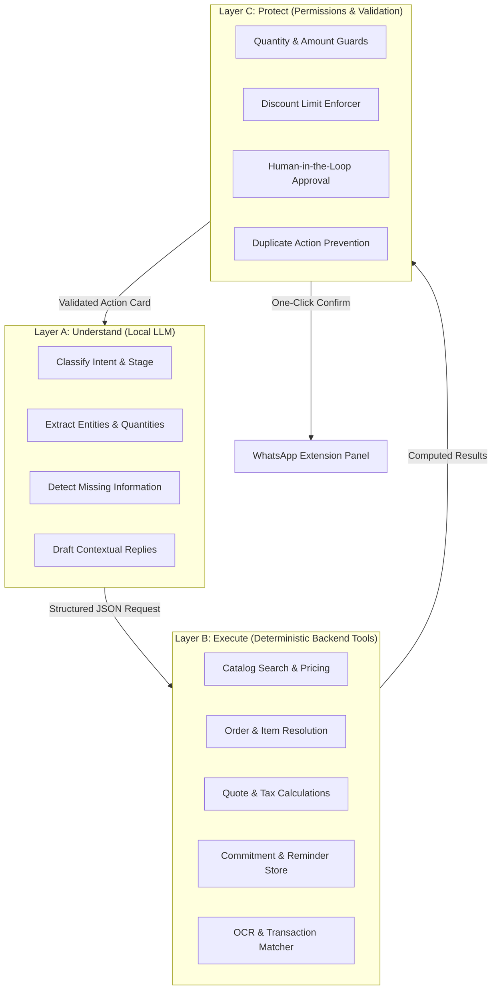
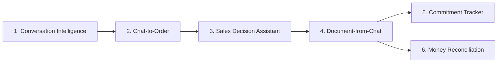
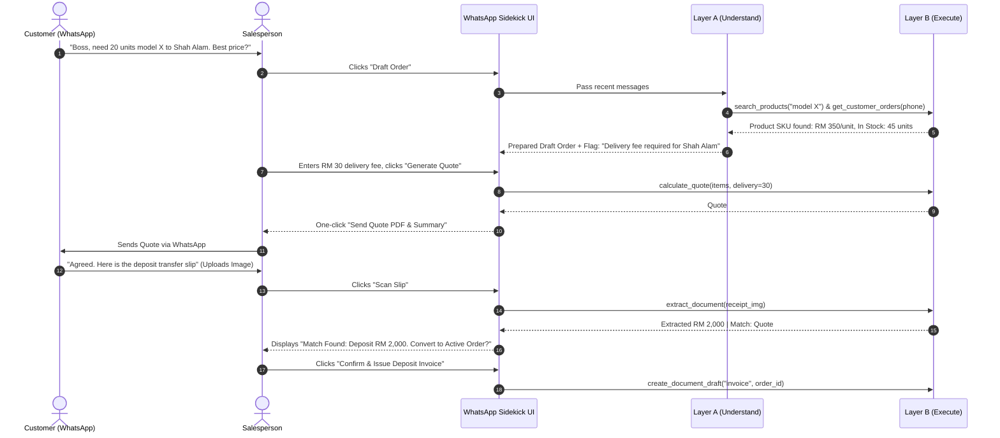
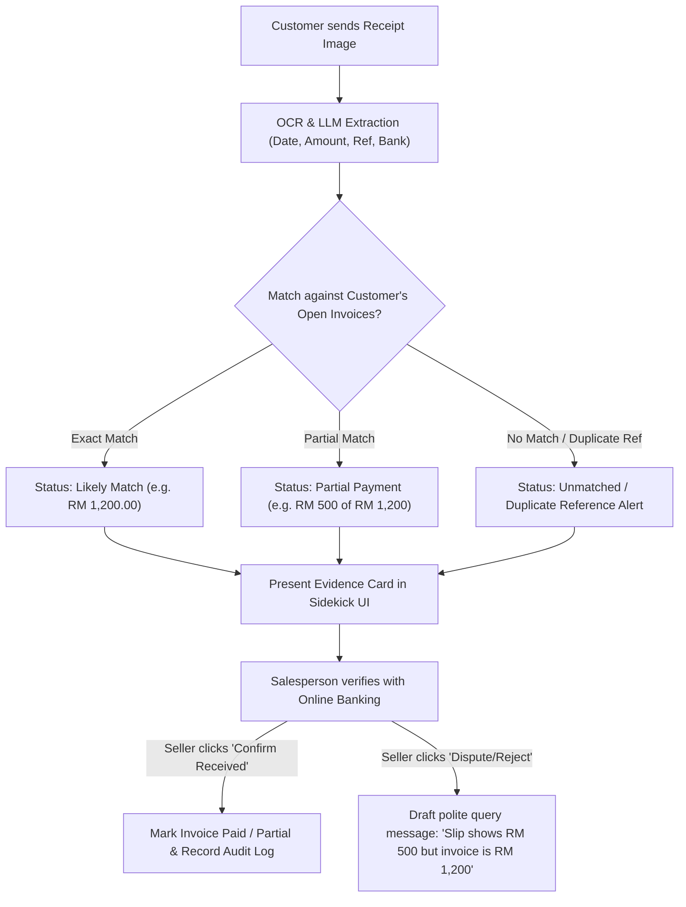

# WhatsApp Sales Sidekick: Practical Agentic Architecture & Plan

> **Core Philosophy:** *What can a salesperson do in WhatsApp in 10 seconds that currently takes 2 minutes, requires switching apps, or is easily forgotten?*
> 
> We pivot away from an over-engineered 4-agent showcase with opaque trust scores and fragile ReAct loops. Instead, we build **one unified Sales Sidekick** that understands the active WhatsApp chat, runs deterministic business tools in the backend, and never forces the salesperson to leave WhatsApp or chat with a bot.

---

## 1. Architectural Pivot: Before vs. After

| Dimension | Previous Proposal (AI Showcase) | Redesigned WhatsApp Sales Sidekick |
| :--- | :--- | :--- |
| **Agent Topology** | 4 autonomous agents passing messages in loops | **1 Orchestrator Sidekick** with modular skills & backend tools |
| **Customer Profiling** | Opaque "Trust Score" (e.g. 94/100) | **Concrete Commitments & History** ("Promised transfer by Friday") |
| **Payment Verification** | DuitNow regex formatting check treated as truth | **Evidence-Based OCR:** Receipt is evidence to inspect, not bank proof |
| **Pricing & Margins** | Hardcoded 15% margin floors & 40% deposit rules | **Deterministic Rules Engine:** Configurable seller business policies |
| **LLM Tool Load** | 25+ exposed functions to a 3B/4B local model | **10 High-Value Compact Operations** cleanly separated into layers |
| **User Experience** | Separate chatbot modal requiring chat input | **Non-intrusive Extension Sidecar** with 10-second action pills |

---

## 2. The 3-Layer Architecture

To ensure high reliability on local models (such as `Qwen 2.5 3B/7B` in LM Studio) and zero hallucinations in financial math, the system is strictly split into 3 layers:

### Layer A — Understand (Local LLM)
- **Role:** Understand informal, multilingual (English, Manglish, Malay, Chinese) chat messages.
- **Tasks:**
  - Classify intent (inquiry, modification, commitment, price pushback, receipt sent).
  - Extract structured order parameters (product keywords, variant, quantity, delivery location).
  - Identify missing details before the seller quotes or commits.
  - Draft response options (Professional, Casual/Friendly, Firm).

### Layer B — Execute (Deterministic Backend)
- **Role:** Perform 100% accurate database operations, mathematical calculations, and catalog lookups.
- **Compact Toolset (10 Operations):**
  1. `get_conversation_context(phone)`: Recent chat summary, open orders, and unfulfilled commitments.
  2. `search_products(query, category, limit)`: Fuzzy match catalog SKUs, stock levels, and tiers.
  3. `get_customer_orders(phone, limit)`: Fetch order history (enables "Same as last month" resolution).
  4. `prepare_order(customer_id, items, delivery_address, notes)`: Create draft order structure.
  5. `calculate_quote(items, discount_pct, delivery_fee)`: Pure deterministic math (subtotal, SST, total).
  6. `create_document_draft(type, order_id, terms)`: Generate editable Quotation or Invoice.
  7. `extract_document(file_id, doc_type)`: OCR extraction of payment receipts and supplier bills.
  8. `match_transaction(amount, date, reference, customer_id)`: Correlate payment with open invoices.
  9. `save_commitment(phone, promise_text, due_date, party)`: Log dated promises ("customer promises to pay Friday").
  10. `get_pending_actions(phone)`: Pending follow-ups, expiring quotes, unverified payments.

### Layer C — Protect (Permissions & Validation)
- **Role:** Safety net preventing financial errors or unwanted automated actions.
- **Guards:**
  - Ensures prices and discounts do not exceed salesperson authorization limits.
  - Prevents issuing duplicate invoices or sending messages without seller confirmation.
  - Requires explicit salesperson sign-off ("Approve & Send") for every business action.

---

## 3. The 6 Practical Sales Skills

### Skill 1: Conversation Intelligence
- **What it does:** Reads the current chat thread to identify:
  - Deal stage (Cold inquiry, Evaluation, Price objection, Closing, Post-sale).
  - Unanswered customer questions or unresolved objections.
  - Multilingual nuances ("Can discount sikit?", "Boleh hantar esok?").
- **Output:** 2-3 instant reply pills (e.g. `Consultative`, `Direct/Closing`, `Value-add`) with inserted real catalog prices.

### Skill 2: Chat-to-Order
- **What it does:** Converts messy WhatsApp text into a structured order.
  - Handles references like: *"Boss, same model as last month, but 20 units to Shah Alam"*.
  - Calls `get_customer_orders` to identify the SKU from last month.
  - Identifies missing fields: *"Missing: Confirm delivery charge & stock availability for 20 units"*.
- **Output:** Editable Order Card right inside the WhatsApp extension.

### Skill 3: Sales Decision Assistant
- **What it does:** Empowers the seller during price pushbacks:
  - Compares requested models with inventory stock levels.
  - Recommends authorized alternatives if an item is out of stock or over budget.
  - Displays permitted discount thresholds without revealing company margins to the buyer.
  - Provides objection-handling battlecards ("Client says competitor is RM50 cheaper").

### Skill 4: Document-from-Chat
- **What it does:** Single-data-entry pipeline:
  - Conversation $\rightarrow$ Draft Order $\rightarrow$ Quotation $\rightarrow$ Tax Invoice.
  - The salesperson never retypes customer name, address, SKU, or prices.
  - Generates PDF/shareable link with 1 click.

### Skill 5: Commitment Tracker (Promises over Scores)
- **What it does:** Detects temporal commitments made by either party:
  - *Customer:* "I will bank in by 3pm tomorrow" $\rightarrow$ Sets alert for tomorrow 3:30pm.
  - *Customer:* "Hold 10 units for me until Monday" $\rightarrow$ Logs soft reservation note.
  - *Seller:* "I will check with warehouse and let you know" $\rightarrow$ Reminds seller in 2 hours.
- **Output:** Actionable commitment checklist with Snooze / Done / Dismiss buttons.

### Skill 6: Money & Transaction Reconciliation (OCR as Evidence)
- **What it does:** Processes payment slips sent by customers:
  - OCR extracts: Bank name, Date & Time, Amount (RM), Recipient Name, Reference ID.
  - Matches against pending unpaid invoices for this customer.
  - **Crucial Rule:** Receipts are treated as *Evidence to Review*, not automatic proof of funds.
  - Shows side-by-side comparison: Slip Amount vs. Invoice Balance.
  - One-click "Confirm Received & Mark Paid" or "Flag Discrepancy".

---

## 4. The Core Prioritized Sales Pipeline

The single most valuable workflow to implement first:

---

## 5. OCR & Receipt Verification Flow

Receipt images are often forged, edited, or sent with wrong amounts. The system treats OCR as an evidence-parsing assistant, not a blind validator:

---

## 6. Implementation Roadmap & Milestones

### Stage 1: Conversation Intelligence & Copilot Prompts (In Progress / Operational)
- [x] WhatsApp extension UI loading & cache buster fix.
- [x] Multi-style reply prompts (Consultative, Direct, Friendly) with catalog price insertion.
- [ ] Implement `get_conversation_context` tool with prompt caching.

### Stage 2: Chat-to-Order & Catalog Matching (Priority Next)
- [ ] Backend endpoint: `POST /api/v1/copilot/extract-order`.
- [ ] Product SKU fuzzy search with stock availability check.
- [ ] Missing information detector (missing address, variant, delivery details).
- [ ] Sidekick UI: Interactive Draft Order Card with "Edit" & "Confirm" buttons.

### Stage 3: Quotation & Invoice Generation (The Core Pipeline)
- [ ] Deterministic quote calculation tool (`calculate_quote` with SST/discounts).
- [ ] Conversion: `Draft Order` $\rightarrow$ `Quotation` $\rightarrow$ `Invoice`.
- [ ] 1-click shareable quote summary formatted for WhatsApp.

### Stage 4: Commitment Tracker
- [ ] Extract temporal commitments from chat text ("transfer tomorrow", "reserve till Friday").
- [ ] SQLite/PostgreSQL `commitments` table with status (`pending`, `completed`, `dismissed`).
- [ ] Sidekick UI: Commitment widget with 1-click snooze and completion tracking.

### Stage 5: OCR Evidence Extraction & Payment Reconciliation
- [ ] Tesseract/Vision OCR extraction endpoint for receipt images.
- [ ] Auto-match extracted amount and reference against customer's open balance.
- [ ] Sidekick UI: "Payment Evidence Card" with one-click verification and audit log.

### Stage 6: Sales Analytics & Multi-rep Support
- [ ] Customer order history drawer in sidebar.
- [ ] Receivables and overdue payment tracker.
- [ ] Performance and conversion metrics.

---

## 7. Verification & Testing Protocol

1. **Unit Testing:**
   - Execute `pytest test/unit` (maintain 100% green pass rate across all 109+ tests).
   - Add unit tests for `calculate_quote` (rounding, discounts, tax) and `save_commitment`.
2. **Schema & Contract Testing:**
   - Verify all 10 tools return valid Pydantic schemas.
3. **Manual Verification Workflow:**
   - Provide explicit, step-by-step instructions for the user to test the WhatsApp Sidekick extension on mock chats (no browser automation).
