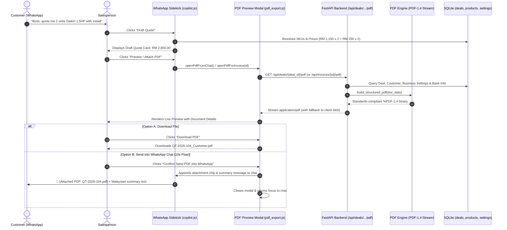

# 16. PDF Generation Architecture & UI Linkage Specification

> **Goal:** Design and specify the end-to-end PDF quotation and invoice lifecycle, documenting exactly which backend modules generate the PDF, how endpoints route requests, how the UI/extension triggers and previews documents, and how the salesperson sends PDFs into WhatsApp within 10 seconds.

---

## 1. System Flow Overview



---

## 2. Codebase Audit: Where It Lives & What Is Calling What

### A. Current Backend State
1. **Module**: [`backend/routes/exports.py`](file:///c:/Users/frede/OneDrive/Desktop/CashChase/backend/routes/exports.py)
   - Function `build_valid_pdf_bytes(lines: List[str]) -> bytes`: A zero-dependency PDF 1.4 binary stream generator using Helvetica Type1 fonts.
   - Endpoint: `GET /api/deals/{deal_id}/pdf`
     - Queries `orm.Deal`, `load_business(s)`, `get_customer(s)`, and `orm.Rep`.
     - Generates plain text monospace lines.
     - Returns `Response(content=..., media_type="application/pdf")`.
2. **The Disconnect (Gap 1)**:
   - Frontend calls `GET /api/invoices/{cleanId}/pdf`.
   - Backend only exposes `GET /api/deals/{deal_id}/pdf`.
   - Result: Frontend receives `404 Not Found` and silently falls back to client-side JS generation in `pdf_export.js`.
3. **Layout Limitations (Gap 2)**:
   - Output is currently plain ASCII lines (`"==="`, `"---"`, `"TOTAL: RM ..."`).
   - Missing professional Malaysian SME essentials:
     - Company Header with SSM registration number, SST ID, and official address.
     - Buyer details (Customer TIN, Phone, Delivery Address).
     - Structured tabular columns (No., Item/SKU, Qty, Unit Price, Line Total).
     - Payment instructions (Maybank / CIMB Account Number & DuitNow QR placeholder).
     - Formal quotation validity (7 days) and terms.

### B. Current Frontend State
1. **Module**: [`webapp/js/pdf_export.js`](file:///c:/Users/frede/OneDrive/Desktop/CashChase/webapp/js/pdf_export.js)
   - `openPdfForInvoice(id)`: Reads invoice from `getState().invoices` and displays `#pdf-modal`.
   - `openPdfFromChat()`: Reads deal data from active chat and displays `#pdf-modal`.
   - `downloadInvoicePdf()`: Attempts `fetch(/api/invoices/${cleanId}/pdf)`, falls back to `buildClientSidePdfBlob(lines)`.
   - `attachPdfToWhatsApp()`: Appends `📎 [Attached PDF: ...]` into active chat messages.
2. **Module**: [`webapp/js/copilot.js`](file:///c:/Users/frede/OneDrive/Desktop/CashChase/webapp/js/copilot.js)
   - Line 309: Renders `<button onclick="openPdfFromChat()">` in the extension footer.
3. **Module**: [`webapp/js/dashboard.js`](file:///c:/Users/frede/OneDrive/Desktop/CashChase/webapp/js/dashboard.js)
   - Lines 143, 254, 339, 604: Renders `<button onclick="openPdfForInvoice('${inv.id}')">Preview PDF</button>` in tables and inspector drawers.
4. **DOM Markup**: [`webapp/index.html`](file:///c:/Users/frede/OneDrive/Desktop/CashChase/webapp/index.html)
   - Contains `#pdf-modal` with header, items list, total badge, "Download PDF" button, and "Send PDF Now" button.

---

## 3. User Review Required

> [!IMPORTANT]
> **Zero-Dependency PDF Generator vs. Heavy Libraries**:
> DealPilot uses a self-contained, high-performance binary PDF 1.4 stream builder. We deliberately **do not** install heavy, external dependencies like `weasyprint` (which requires GTK+/Pango C-libraries that fail on Windows) or `reportlab`.
> We will upgrade the built-in PDF generator to draw clean tabular borders, right-aligned currency columns, and professional Malaysian SME branding blocks directly in the PDF stream.

> [!NOTE]
> **Unified Route Resolution**:
> We will alias `/api/invoices/{id}/pdf` to `/api/deals/{id}/pdf` so that whether a user requests a quote (`QT-2026-101`), an invoice (`INV-204`), or a sales order (`SO-2026-103`), the backend cleanly resolves and formats the correct document type.

---

## 4. Proposed Changes

### Component 1: Upgraded Backend PDF Generator & Routing

#### [MODIFY] [`backend/routes/exports.py`](file:///c:/Users/frede/OneDrive/Desktop/CashChase/backend/routes/exports.py)
1. Add route alias `@router.get("/api/invoices/{invoice_id}/pdf")` pointing to the PDF generator.
2. Upgrade `build_valid_pdf_bytes` into a structured document renderer `render_document_pdf(doc_data)`:
   - **Header Block**: Company Name, SSM No., Contact Phone, Email, LHDN TIN.
   - **Document Meta**: Document Type (QUOTATION / TAX INVOICE / SALES ORDER), Document Ref, Date, Expiry Date, Sales Rep.
   - **Bill To**: Customer Name, Phone, Delivery Address, Customer TIN.
   - **Item Table**: Clean visual column layout (`Item #`, `Description / SKU`, `Qty`, `Unit Price (RM)`, `Total (RM)`).
   - **Totals Summary**: Subtotal, Discount, Delivery/Labor Fee, Grand Total (RM).
   - **Payment & Bank Instructions**:
     ```
     Payment Details:
     Bank Name    : Maybank Berhad
     Account Name : DealPilot Trading Sdn Bhd
     Account No   : 5140-1234-5678
     DuitNow ID   : 202601009988 (SSM)
     ```
   - **Footer Disclaimer**: `"Subject to stock availability. Valid for 7 days."`

```python
# Code sketch for /api/invoices/{id}/pdf in backend/routes/exports.py:
@router.get("/api/invoices/{invoice_id}/pdf", response_class=Response)
@router.get("/api/deals/{deal_id}/pdf", response_class=Response)
def api_document_pdf(deal_id: Optional[str] = None, invoice_id: Optional[str] = None) -> Response:
    target_id = deal_id or invoice_id
    with session_scope() as s:
        # Resolve deal or synthesize from invoice
        doc_data = resolve_document_data(s, target_id)
        if not doc_data:
            raise HTTPException(status_code=404, detail=f"Document {target_id} not found")
        pdf_bytes, filename = render_document_pdf(doc_data)
    return Response(
        content=pdf_bytes,
        media_type="application/pdf",
        headers={"Content-Disposition": f'attachment; filename="{filename}"'},
    )
```

---

### Component 2: Frontend PDF Exporter & Routing Fix

#### [MODIFY] [`webapp/js/pdf_export.js`](file:///c:/Users/frede/OneDrive/Desktop/CashChase/webapp/js/pdf_export.js)
1. Align fetch URL with backend:
   ```javascript
   // Query backend with fallback
   const res = await fetch(`${BACKEND_API_BASE}/api/deals/${encodeURIComponent(cleanId)}/pdf`);
   if (!res.ok) {
     // Try alternate invoice route
     const resInv = await fetch(`${BACKEND_API_BASE}/api/invoices/${encodeURIComponent(cleanId)}/pdf`);
     ...
   }
   ```
2. Upgrade `buildClientSidePdfBlob(lines)` fallback to match the structured format if the backend is offline.
3. Enhance `attachPdfToWhatsApp()`:
   - When the user confirms sending the PDF, format the message to include:
     1. Attachment badge chip: `📄 [Attached: ${currentPdfDocId}.pdf]`.
     2. Polite Malaysian summary:
        `"Hi Boss, attached is Quotation #${cleanId} for ${itemsSummary}. Total: RM ${total}. Valid for 7 days. Bank details: Maybank 5140-1234-5678."`
     3. Toast notification: `"Quotation PDF attached and ready to send!"`

---

### Component 3: WhatsApp Sales Sidekick Document Action Card

#### [MODIFY] [`webapp/js/copilot.js`](file:///c:/Users/frede/OneDrive/Desktop/CashChase/webapp/js/copilot.js)
1. Add an inline Document Action Card inside the Copilot panel when an order or quote is drafted:
   ```html
   <div class="mt-3 p-3 bg-white rounded-lg border border-[#D5DFEE] shadow-sm">
     <div class="flex items-center justify-between text-xs font-bold text-[#1A202C]">
       <span class="flex items-center gap-1.5">
         <svg class="w-4 h-4 text-[#0152FC]"><use href="#i-file"/></svg>
         Quotation #QT-2026-104
       </span>
       <span class="text-[#0152FC] font-extrabold">RM 2,800.00</span>
     </div>
     <div class="flex gap-2 mt-2.5">
       <button onclick="openPdfFromChat()" class="flex-1 py-1.5 px-2 bg-[#F0F4FF] hover:bg-[#E6EEFF] text-[#0152FC] text-xs font-bold rounded border border-[#CCD9FF] transition">
         Preview PDF
       </button>
       <button onclick="quickSendPdfToChat()" class="flex-1 py-1.5 px-2 bg-[#0152FC] hover:bg-[#0040D0] text-white text-xs font-bold rounded transition">
         Attach to Chat
       </button>
     </div>
   </div>
   ```

---

## 5. Verification Plan

### Automated Tests
1. **Backend Route & PDF Binary Verification**:
   ```powershell
   pytest test/unit/test_deals.py -k "pdf" -v
   ```
   - Verifies `GET /api/deals/{id}/pdf` returns 200 with `%PDF-1.4` header.
   - Verifies `GET /api/invoices/{id}/pdf` returns 200 with `%PDF-1.4` header.
   - Verifies 404 for invalid document IDs.
   - Verifies PDF content stream contains company name, bank details, and Malaysian disclaimer.
2. **Full Regression Suite**:
   ```powershell
   pytest test/unit
   ```
   - Maintain 100% green pass rate across all 109+ unit tests.

### Manual Verification
1. Start backend server:
   ```powershell
   python -m uvicorn backend.main:app --port 8000
   ```
2. Open [`webapp/index.html`](file:///c:/Users/frede/OneDrive/Desktop/CashChase/webapp/index.html) in your browser:
   - Navigate to the **WhatsApp Demo** tab.
   - Select a chat (e.g. Chat 1: Tan Bros Trading).
   - Look at the extension sidebar: click **"Attach PDF document"** (or **"Preview PDF"**).
   - In `#pdf-modal`, click **"Download PDF (.pdf)"** $\rightarrow$ verify the downloaded PDF opens in Adobe Acrobat or browser with valid formatting and bank details.
   - Click **"Confirm Send PDF into WhatsApp"** $\rightarrow$ verify message appears in the chat thread with attachment chip and polite summary.
   - Navigate to the **Dashboard** tab $\rightarrow$ click **"Preview PDF"** on any invoice $\rightarrow$ verify it opens and downloads correctly.
